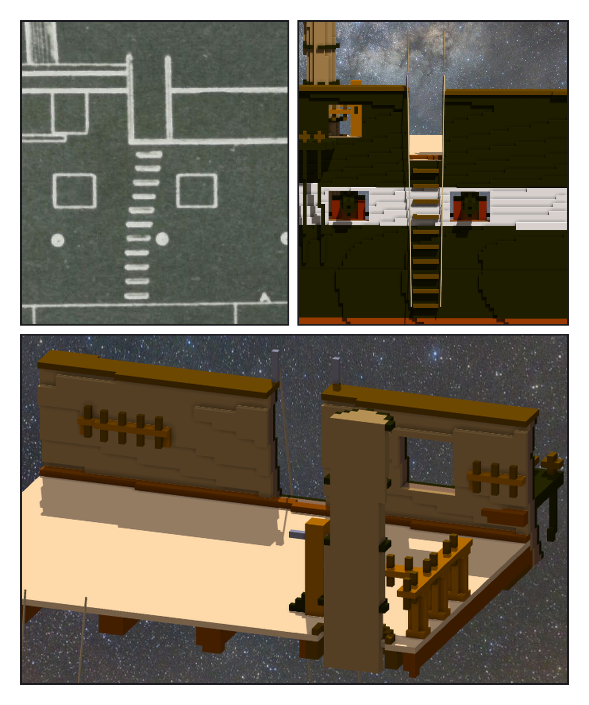
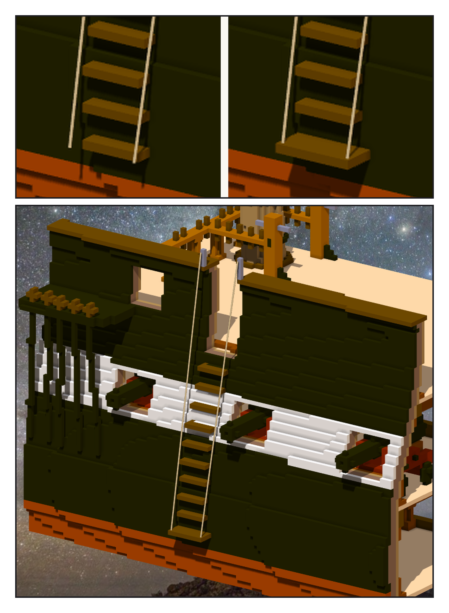

# 第 027 話〈最下面那一道〉

## P1 — 圖上就有

**P1-①**〔11 號 sheer plan：主桅 channel 前，gun deck 兩個砲門之間〕
　字幕：「Tim：繼續造船吧 GO。—— 候選清單第一個：從小艇上船，是爬船側釘的一排木條。」
　字幕：「上網只查到幾句搜尋摘要。回到一九二七年的圖：十一道橫條，上面舷牆斷開，兩側各一根柱。」
　字幕：「上一章讀這張圖，框的右緣停在 2130 像素。第一根柱子在 2168。」

**P1-②**〔作品：右舷正側〕
　字幕：「間距 3.74 ⇒ 每四格一道、十道、排直。凸出兩格，cap rail 的深木色。」
　字幕：「開口九格，切穿 cap rail，兩舷各 740 格。鐵柱立在欄杆外緣 —— 站中間的話，繩會穿過欄杆。」

**P1-③**〔從艙裡看開口：左 pinrail-7、右 pinrail-5〕
　字幕：「開口裡原本站著 pinrail-6。綁在它上面的繩：0。同一把查詢查所有 pin rail：14 筆。整根拿掉。」

---

## P2 — 綁在虛空中

**P2-①**〔左：v1　右：v1.1〕
　字幕：「第一版，直線的中心線在白帶下緣一帶進到船殼裡 —— 船身往下變寬。下端往外挪一格半。」
　字幕：「Tim：『另外這個好像綁在虛空中(船的外殼梯底部)』」
　字幕：「我量了繩離船殼多遠，量到小數點後好幾位。繩的兩端綁在什麼上面，我沒有量。」
　字幕：「改踏階，不改繩：最下一道加寬到開口那麼寬、凸出四格。兩個角，正好接住繩端。」

**P2-②**〔v1.1 斜看〕
　字幕：「一舷多 22 格，舊的 151 格一格沒變。1,433,632。」
　字幕：「水面上三格，最寬的那一道；往上九道，穿過白帶，到舷牆斷開的地方。從那個口望進去，是甲板。」
