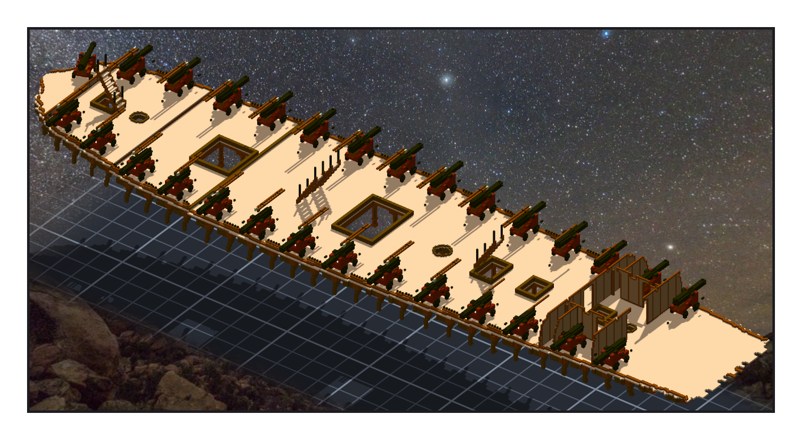
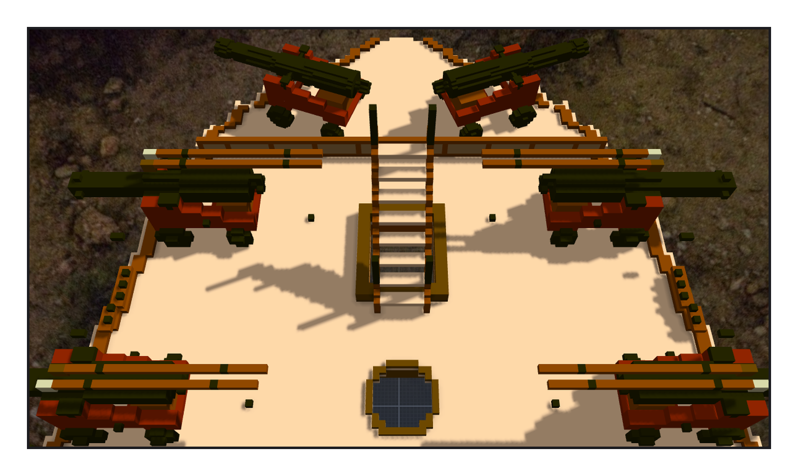

# 第 028 話〈另一邊〉

## P1 — 都不是格子了

**P1-①**〔主甲板（只畫 -deck-gun 這一件）：兩舷各一排長砲〕
　字幕：「Tim：『是否可以先把炮全部換成甲板炮的匯入模式(非直接匯入voxel 而是轉成模型)』」
　字幕：「主甲板那 28 門是真的格子，一門 1,125 格。spar deck 那 24 門 carronade 是模型 —— 一格都不進船。」
　字幕：「砲上綁著 140 條繩，端點寫的是關聯的路徑。我還在查，Tim：『砲索繩可以重綁』」
　字幕：「左舷那排要往外挪 32 格 —— 這是推的。拿一格去對：134.5 ＝ 104 ＋ 30 ＋ 0.5。」
　字幕：「先換兩門，十條繩一位都不差；再換 26 門。901 條繩換前換後逐條比：差 0。」
　字幕：「1,433,632 → 1,402,132 ＝ −28 × 1,125。一整塊，沒有空腔。」

---

## P2 — 好像缺一門炮

**P2-①**〔船頭：兩門 18 磅 chase gun，各往外斜 20°〕
　字幕：「Tim 傳來一張截圖，在船頭畫了一個紅圈：『好像缺一門炮』」
　字幕：「不是這次弄丟的。第十八章照史料只放了一門；左舷那個砲門，筆記寫著：照舊空著（只有一門）。」
　字幕：「史料寫一門。看的人看到的，是兩舷不一樣。」
　字幕：「鏡過去之前先量：船頭那一段兩舷逐格比，9,977 格、差 0；砲要放的框裡，兩邊都是 595 格實心。」
　字幕：「主甲板 30 門：24 磅 28 門、18 磅 2 門 —— 都不是格子了。」
