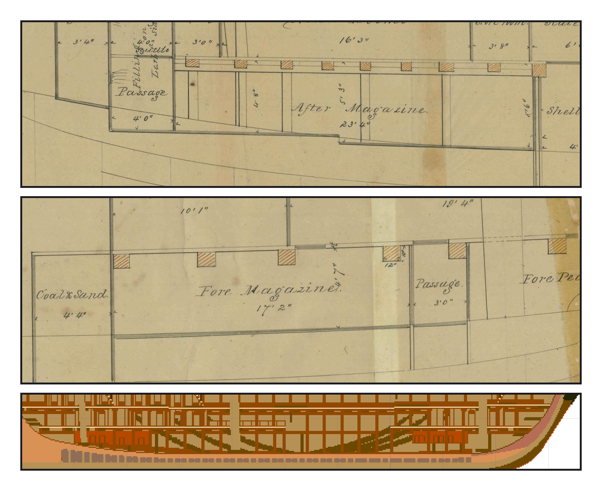
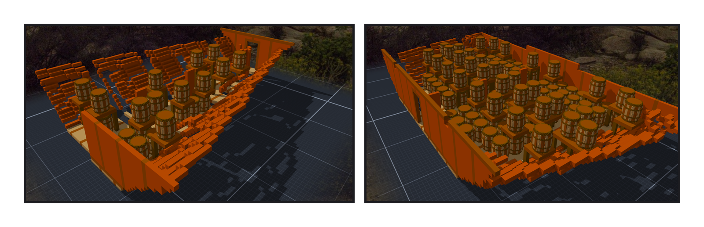

# 第 029 話〈桶上的板子〉

## P1 — 圖上寫著

**P1-①**〔02 號圖（1849 Pook）：船尾那一段〕
　字幕：「Tim：『另外完成後 可以規劃一下放置彈藥庫(單獨子模組) 因為遊戲想要模擬彈藥庫爆炸』」
　字幕：「規劃交出去，Tim：『彈藥庫可以根據史實(如果兩版本都有 那就兩個的吧)』」
　字幕：「派一位去讀圖。『After Magazine』『23'4"』—— 我自己算一次：23 呎 4 吋 × 74.47 像素 ＝ 1,737；它量的是 1,740。換到作品 x 199.9–271.1。淨高 4'8"、5'3"、5'6"，地板中間往下一階。」

**P1-②**〔同一張圖：船頭那一段〕
　字幕：「『Fore Magazine』『17'2"』，淨高 4'7"，在前桅後面。x 521.3–573.7。」
　字幕：「1812 年的日誌也是前後兩間（那一頁是查的人讀的，我沒打開）。」

**P1-③**〔作品：中線剖開〕
　字幕：「orlop 底下兩塊銅色：一塊從後桅往前，一塊停在前桅後面。」

---

## P2 — 桶是模型

**P2-①**〔後彈藥庫：22 桶〕
　字幕：「火藥桶另做一件，0.02 公尺一格，木頭的箍。Tim：『火藥桶可以做(彈藥庫的子模組 跟炮一樣的引用方法)』」
　字幕：「第一次落格接上去：格數對，沒有重疊。元件數 20。」
　字幕：「19 塊多出來的全是架板 —— 立柱碰到下層的桶就停了。桶是模型，不是格子。遊戲算的是格子：連不上，就會掉下去。」

**P2-②**〔前彈藥庫：116 桶〕
　字幕：「第二版，地板那一層的桶從 82 變 85 —— 這一版不該動到地板。查：排桶的起點跟著牆挪了一格，桶貼到牆上。」
　字幕：「1,413,088。一塊，沒有空腔。每一間一個 blast。」
　字幕：「Tim：『可以 提交然後出廠 powder_lb照妳的算法』—— 一個桶 100 磅。後 2,200、前 11,600；這是模型裡的桶換的，不是史料。」
