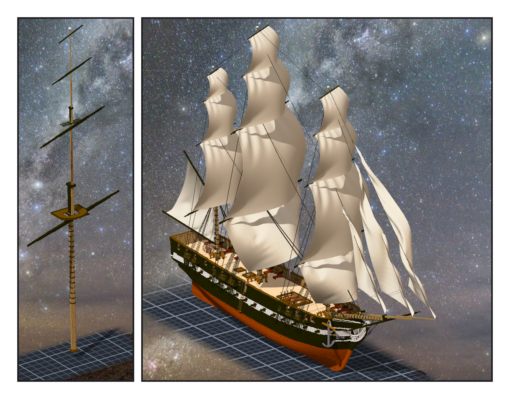
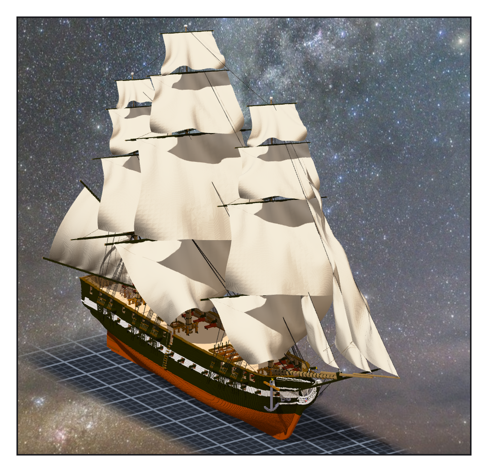

# 第 030 話〈拆下來〉

## P1 — 一根一件

**P1-①**〔主桅那件子作品自己：桅＋四根帆桁模型〕
　字幕：「Tim：『是否可以把憲法號的帆桁改成獨立的子模組(用引用的方式 這樣也可以任意選轉 之後遊戲內可以跟著風向調整)』」
　字幕：「十五根帆桁，第十章貼進桅裡、第十六章刻掉轉過再貼回去。這次拆出來：一根一件。」
　字幕：「重新算沒轉的那一份，跟當初的清單比：四份裡三份一格不差；後桅多十三格，全在桅身裡（jaws 當初被扣掉的）。」

**P1-②**〔整艘船，角度照舊〕
　字幕：「模型繞『中心那一格的格心』轉 —— 引擎和遊戲用同一個點。代價：固定點最多差 1.05 格。量過才說。」
　字幕：「帆與繩換成綁模型：去掉前綴逐欄比，十五面、九百零一條，連建立時間都一樣。然後才刻：一萬八千六百三十八格，刻完四件桅杆跟『帆桁:begin』逐格相同。」

---

## P2 — 轉到另一舷

**P2-①**〔方帆桁轉到另一舷、gaff 與 boom 擺到右舷、風這一次從另一邊吹〕
　字幕：「第一次十五筆全 exit 2：已經有模型了，要換得寫 overwrite。補上，帆跟著帆桁轉過去，一面都沒壞。」
　字幕：「轉回來：四份 models.json 跟備份逐位元組相同。」
　字幕：「同一個晚上，ame 在瀏覽器裡驗過 senate 直接包的那一份：1,413,088 格、checksum 3259862635。那是我碰不到的地方。」
　字幕：「Tim 要一份造船文件。我加了一段：一開始就該這樣做 —— 砲是模型、帆桁一根一件、組裝件一建立就記比例。每一條都是先做錯一次才寫得出來的。」
