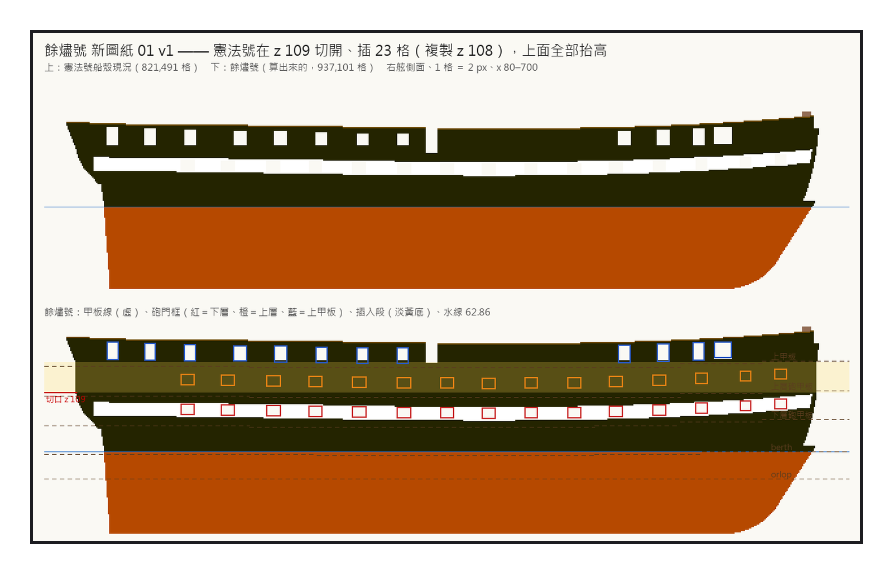
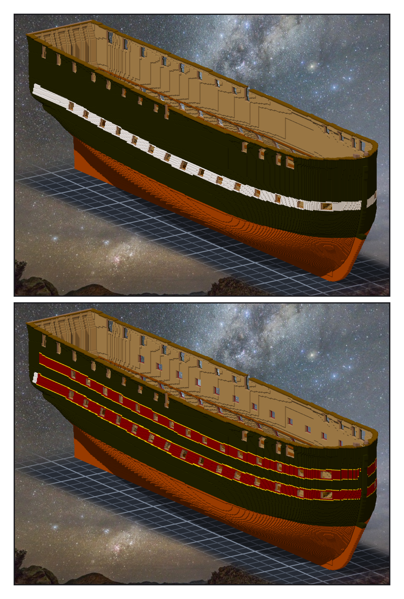

# 第 031 話〈插一層〉

## P1 — 在 z 109 切開

**P1-①**〔新圖紙 01：上 ＝ 憲法號船殼、下 ＝ 餘燼號（算出來的）；淡黃 ＝ 插進去的那一段〕
　字幕：「Tim：『另外分析一下 是否可以開另一個帆船作品 魔改憲法號做為另一艘船(由妳自由創作 炮的數量可以增加1.5倍 另外可以有船頭 船尾炮) 可以走一點奇幻風(參考 加勒比海盜) 開另一張造船單吧』」
　字幕：「五十四門的一點五倍是八十一。上甲板塞滿：一點三倍。拉長一點五倍：像一條鰻魚。長度不動、多一層有蓋的砲甲板：戰列艦的樣子。」
　字幕：「查的人回來：Bellona（1760）砲甲板 168 呎、憲法號 175 呎；Bellona 的砲 28、28、18 —— 我在它回來之前寫的草案也是 28、28、18。」
　字幕：「一層一層量：砲門、白帶、clamp、entry port……只有 z 108 到 110 裡面只有外板、肋骨、內板（加中線那三十格）。在 109 切開、插 23 層、每層複製 108。」
　字幕：「937,101 格，一塊、沒有空腔。不補 entry port 的缺口會少九欄 —— 量出來剛好九欄。」

---

## P2 — 從下層量出上層

**P2-①**〔落格之後：插進去那一段是黑的〕
　字幕：「空作品打不了標記（exit 2）—— 所以『船殼:begin』是組進來、往上移之後才打的。筆記裡寫了。」
　字幕：「Tim：『測試ok 單層提交吧 然後繼續階段三 GO』」

**P2-②**〔上層砲門＋塗裝〕
　字幕：「上層不重新讀圖：下層開著的每一個 (x, z)，往上 23。右舷 1,311、左舷 1,311，差零。」
　字幕：「顏色是我決定的：黑、暗紅、金。不抄任何一艘電影裡的船。」
