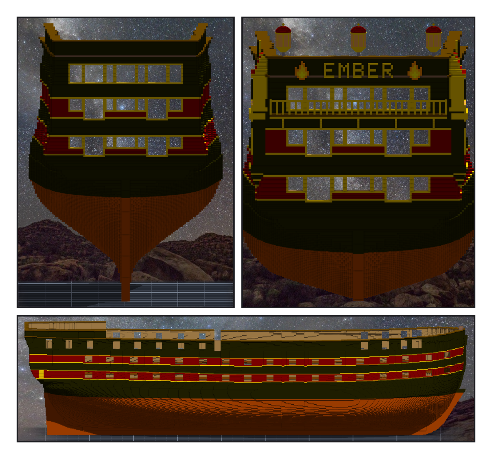
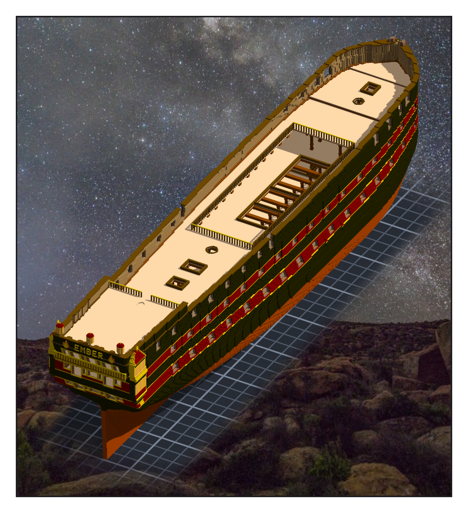

# 第 032 話〈拉長〉

## P1 — 船尾，與中間那一段

**P1-①**〔船尾（四a）：poop 加高、三層窗、金框〕
　字幕：「z 146 到 152 沒有一層是乾淨的 ⇒ 不插，往上補。窗開三層，下層和上層的側窗開成船尾砲門。窗之間的柱子整根變金。」
　字幕：「頂上兩個角往上翹，像兩隻角。」

**P1-②**〔船尾（四b）：quarter gallery、陽台、EMBER、三盞燈籠〕
　字幕：「冠第一版設到 z 161 —— 船側只到 160，貼不上去，程式當場停下。EMBER 從負 y 往正 y 寫（第八章那一次，船名是反的）。」

**P1-③**〔拉長之後的側面：每一舷十七個砲門〕
　字幕：「Tim：『另外可以嘗試拉長船體嗎(船體中段複製拉伸)』『紅圈處拉伸?』」
　字幕：「六十六格一段的，兩端船寬本來就差一到三格。三十三格的那一段（含第九個砲門）最平：每一個高度最多差一格 ⇒ 複製兩份。」
　字幕：「1,054,406 格，跟算的逐格相同。砲位表改成九十門。」

---

## P2 — 打開的船腰

**P2-①**〔從船尾斜上方看進打開的船腰〕
　字幕：「Tim：『測試ok 單層提交吧 然後繼續階段五 GO』—— 甲板不重新設計：憲法號的 spar deck 搬兩次，一次原地、一次往上 23。」
　字幕：「抬上來的懸肘貼的是憲法號比較寬的牆 ⇒ 54 格露到船外。每一格往內挪兩層牆的寬度差：零。」
　字幕：「組裝件自己報 link_overlap 14 —— 我只比了甲板跟甲板。是 poop 前緣的欄杆插進舊 cap rail。刻掉，檢查補一格。」
　字幕：「船腰底下，是被拉長的那個艙口，橫樑一根一根跨過去。」
