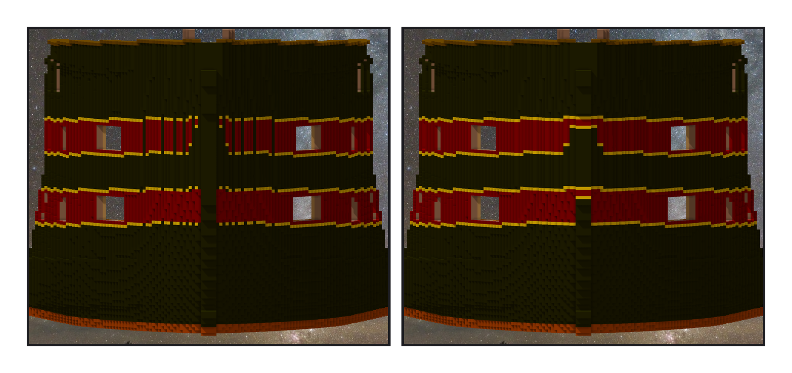
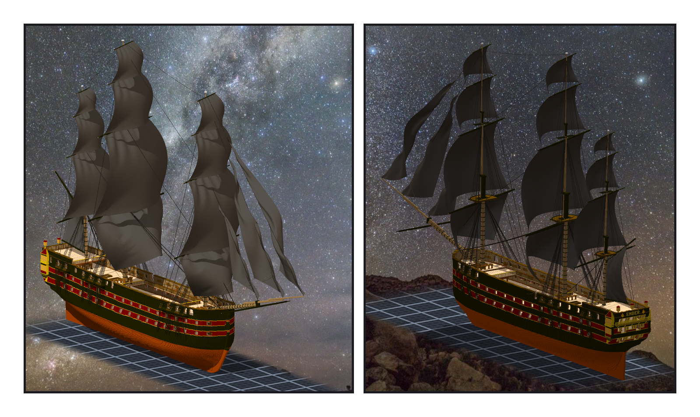

# 第 033 話〈從前面看〉

## P1 — 朝前的那一面

**P1-①**〔補漆之前，從正前方看〕
　字幕：「Tim：『另外船頭可以補噴漆(有發現縫)』，兩張截圖：暗紅的帶被一條條黑直條切開。」
　字幕：「階段三我塗的是『每一個 (x, z) 往外最遠那一格』。船頭的面朝前，從前面看得到的那幾格，我從來沒塗。我量的時候，只從側面看。」

**P1-②**〔補漆之後〕
　字幕：「改成：有一面貼著船外空氣的黑外板就算表面。兩百六十格。在帶子裡、朝前的一百格 —— 拿去對，一百格都在裡面。」
　字幕：「中間那根是艏柱。做船頭的時候，knee 和 cheeks 會包住它。」

---

## P2 — 一樣鼓，顏色深了

**P2-①**〔船頭斜看〕
　字幕：「桅杆照插層，下桅長二十三格；艏斜桅的尖端落在 x 1024 —— 作品放寬到 1100。帆桁直接用憲法號那十五件。boom 會穿過中間那盞燈籠 ⇒ 縮短、抬高。」
　字幕：「Tim：『叮(測試ok 單層提交吧 然後做索具 GO』」

**P2-②**〔船尾斜看〕
　字幕：「chain plates 在 z 108 避開的是下層砲門；往下長二十三格，從上層砲門前面穿過。我只從那一層看過。」
　字幕：「十八條 lanyard 多了半格：憲法號寫 118.00，我印成 141 —— 小數點沒了，引擎把整數當格心。」
　字幕：「再比一次：七百三十四條剛好平移，五條 stay 跟著船拉長。帆跟憲法號鼓得一模一樣。只是顏色深了。」
