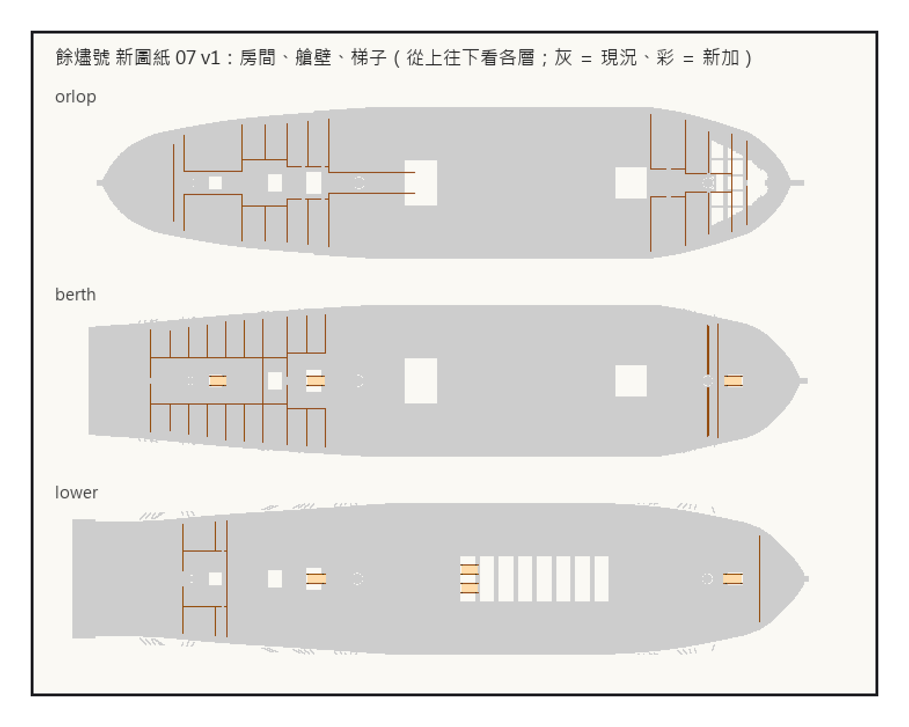
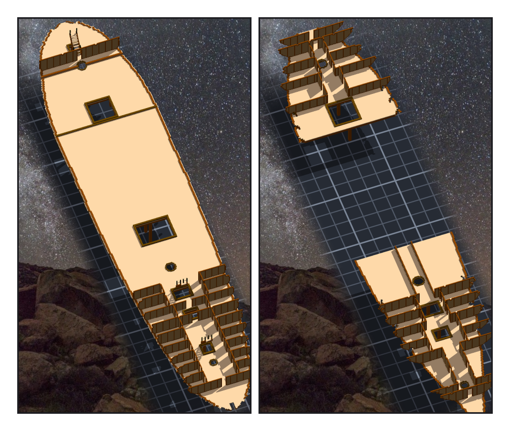

# 第 034 話〈借來的房間〉

## P1 — 三層的房間

**P1-①**〔新圖紙 07：orlop、berth、下層砲甲板，從上往下看；灰 ＝ 現況、彩 ＝ 新加〕
　字幕：「Tim：『然後發現Sculpture是LFS問題導致沒推上去』。最大的一個檔五十六點四 MB —— 餘燼號第一刀，把憲法號整艘放進來的那一刀。拆成一個頭和幾個續；照原檔的格式，兩段，各三十四點五。」
　字幕：「Tim：『另外可以繼續造船了 GO』。房間有幾格落在拉長那一段？零格。換算退化成平移：四三九以前不動，四七二以後往前六十六。」
　字幕：「Tim：『然後有些子物件可以重複使用(例如之前憲法號的舵輪 火藥桶 等)』。berth 和 gun deck 的舷側艙房，換算後跟憲法號一格都不差 —— 不搬了，直接借那兩件。」

---

## P2 — 另一艘船的兩排艙房

**P2-①**〔藏起船殼：berth deck〕
　字幕：「梯子不能逐格搬：下層那兩座正好站在拉長那一段，逐格會變成六座。一座一座整座搬，在那一段裡的只留原地那一份。」

**P2-②**〔藏起船殼：orlop〕
　字幕：「露到船外六十四格？那幾層是砲門，牆是開通的，那一列只剩一根柱子。艦長室在二十四格外，船牆在五十二格外。外緣改成上下各十二層裡最寬的那一層。」
　字幕：「一百七十七萬四千四百三十格，一塊。兩舷那兩排艙房，是另一艘船的。」
