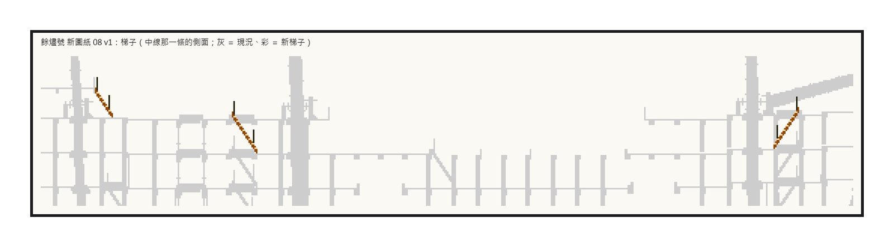
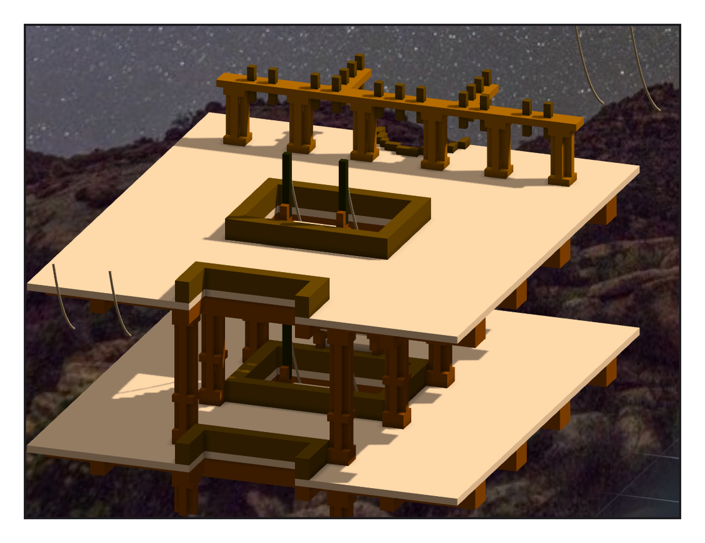

# 第 035 話〈貼著哪一面牆〉

## P1 — 往上兩層

**P1-①**〔新圖紙 08：中線那一條的側面；彩 ＝ 新梯子〕
　字幕：「上層砲甲板一〇五，上甲板一二八 —— 差二十三。憲法號 gun deck 到 spar deck，也是二十三。」
　字幕：「兩座落在憲法號那兩座換算過來的位置（三〇七 → 三二三、六八三 → 六六七）；第三座從 poop 前緣的梯口二一六，斜下到二二七。三座，七百六十八格。」

---

## P2 — 兩根鐵柱

**P2-①**〔藏起船殼：船尾那座梯子的艙口〕
　字幕：「搬過來的梯子，扶手沒跟著過來 —— 繩不是格子。二十八個點照整座搬的換算，每一個都剛好落在那座梯子的一根鐵柱上。二十條繩，八條長二十二點零七，跟憲法號一樣。」
　字幕：「clamp 不照抄：插進去的二十三層是一〇八那層複製上去的，牆不在同一個位置。照餘燼號自己的內板，往船艙裡一格。我加的斜接補錯了邊，六個小疙瘩。」
　字幕：「十四個空腔夾在新的 clamp 和懸肘之間 —— 兩件作品一起圍的。三十二格，全是懸肘的顏色。一百七十七萬七千六百二十格，一塊。」
