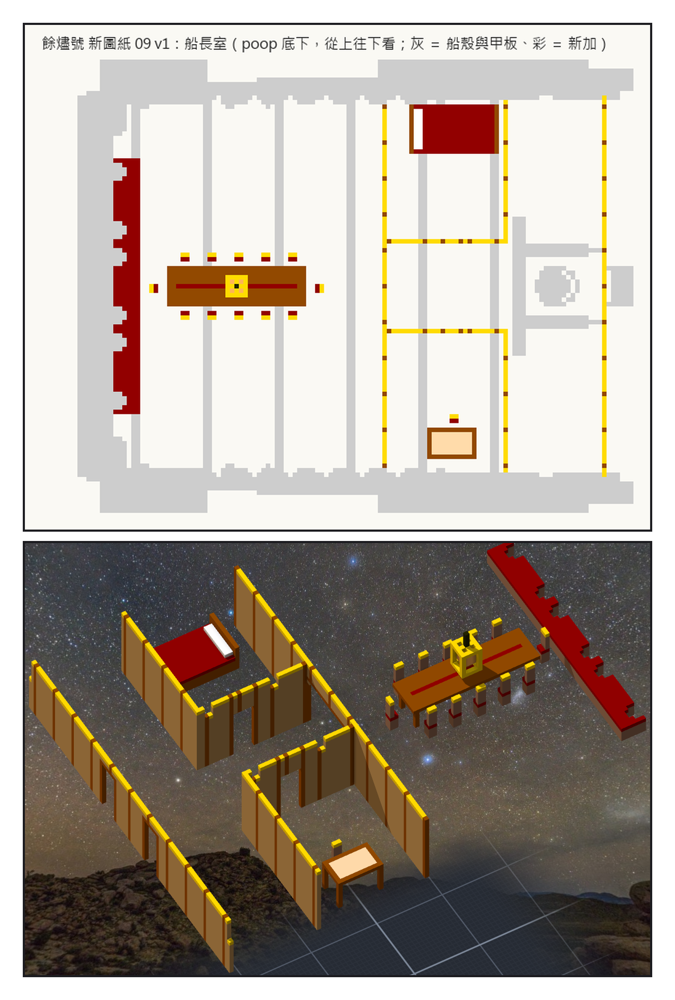
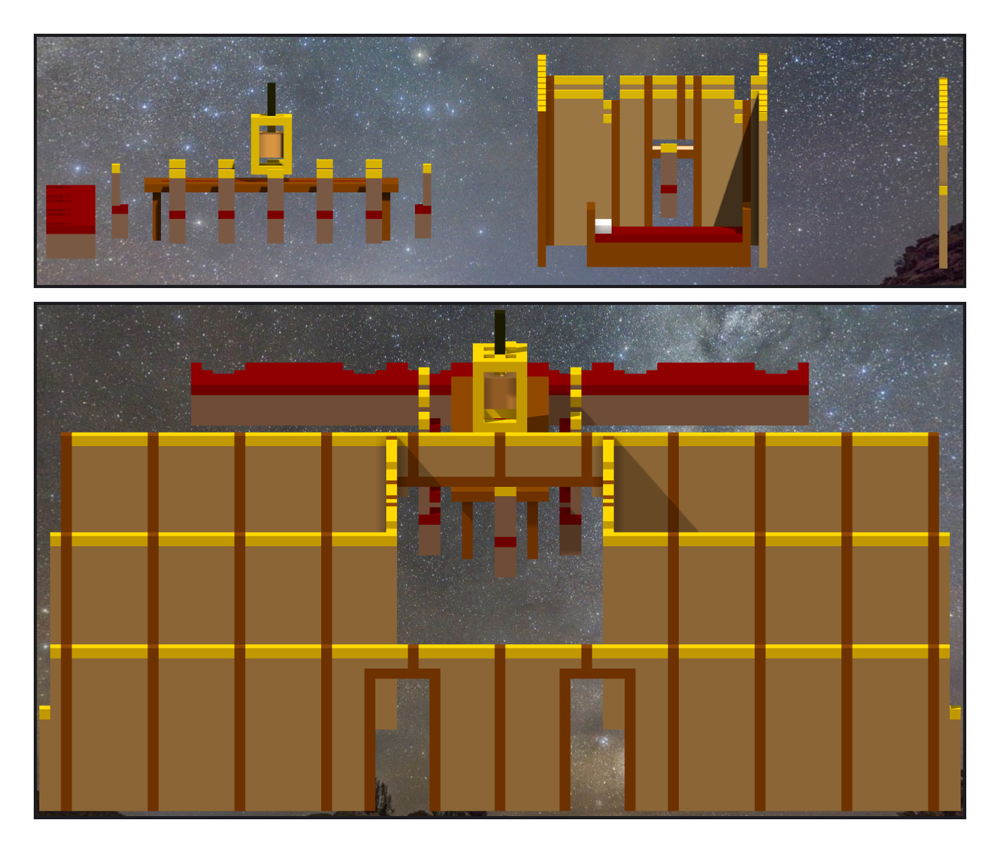

# 第 036 話〈餘燼之心〉

## P1 — 沒有圖紙的那一間

**P1-①**〔新圖紙 09：船長室，從上往下看〕
　字幕：「Tim：『房間也自由發揮吧』。憲法號的房間，我都照圖紙、照年代做。這一間沒有圖紙。」
　字幕：「poop 底下，淨高一點九公尺；兩舷 z 一三八到一四六是砲門 —— 艙裡的牆只到走道兩邊。」

**P1-②**〔船長室這一件，斜上方〕
　字幕：「船尾窗底下一整排長椅；長桌三公尺，十二張椅子；拱口過去，右舷臥艙、左舷海圖室。桌子上方，金色的籠子，裡面一團琥珀色的火。這艘船叫餘燼號。」

---

## P2 — 火和籠子

**P2-①**〔正側面〕
　字幕：「放上去，整艘七塊。二十七格是那團火，五十二格是籠子 —— 籠子只有十二條邊，吊鍊接在籠頂正中間那格空氣上。三樣東西，各自浮著。加一個金十字、一根金桿。」
　字幕：「另外四塊在船外：艙壁從中線往兩舷走，poop 上方露天，一直走到七十格外。」
　字幕：「走道的牆在後桅後面矮了一截 —— 是後桅的 fife rail。它在憲法號上站在露天的 quarterdeck，餘燼號加了 poop，它就被關在這個房間裡了。」

**P2-②**〔從船頭往船尾、稍微抬高一點〕
　字幕：「兩間艙退到一九三，留一塊玄關給後桅；最前面的艙壁移到二一五，兩扇門開在上 poop 的梯子兩邊。七千四百五十八格，整艘一塊。」
　字幕：「Tim：『測試ok 單層提交吧』。兩扇門，門後一道拱口；再過去，長桌上方，有一團火。」
