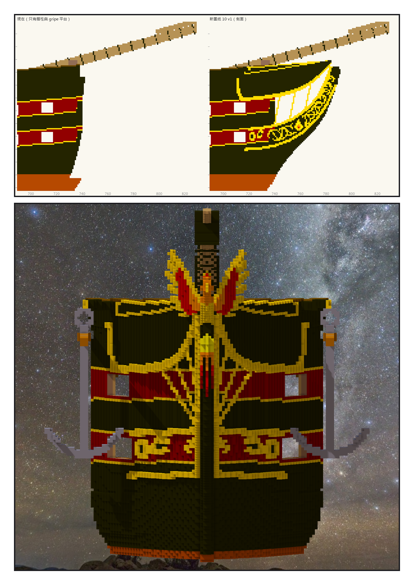
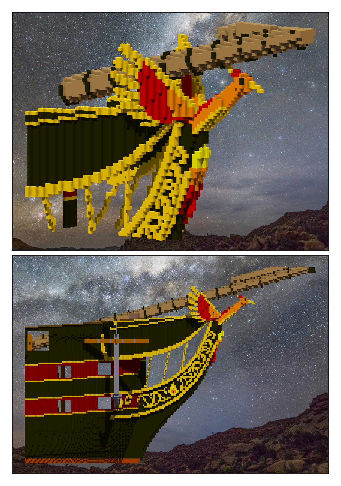

# 第 037 話〈浴火的鳳凰〉

## P1 — 換算上去的船頭

**P1-①**〔新圖紙 10：側面，左 ＝ 之前、右 ＝ v1〕
　字幕：「Tim：『繼續造船吧 GO』。todo 的下一項是船頭。憲法號的 knee、cheeks、rails 都有現成的曲線 —— 照換算搬過來。」
　字幕：「x 加六十六；z 六十三以下不動、六十三到一三一拉成六十三到一五四、一三一以上加二十三。船身插了二十三層，knee 跟著變高，比憲法號直。」

**P1-②**〔正前方〕
　字幕：「白換成金，盾牌換成一團火。灰色的 hawse 圈貼在暗紅帶上，像兩個字母 —— 換成金圈，圈裡一格黑當孔。」
　字幕：「錨不重做：憲法號那一隻，掛在 cathead 底下。第一個試的位置，兩舷都不撞。」

---

## P2 — 一隻往前撲的鳥

**P2-①**〔船首像特寫〕
　字幕：「billethead 不做，換一隻鳳凰：身體趴在 knee 尖上，頭抬到艏斜桅底下，翅膀往後張，尾羽順著 cutwater 往下流 —— 黃、橘、紅、暗紅，從火到餘燼。」
　字幕：「第一版的翅膀是一把分開的羽毛棒。鳥自己散成三十一塊，翅膀有四十八格浮在空中。改成一片羽膜、後緣切出羽尖：浮空零。」

**P2-②**〔正側面〕
　字幕：「一百八十萬三千二百零八格，一塊。缺零、多零、色差零。」
　字幕：「Tim：『測試ok 單層提交吧 然後繼續』。」
