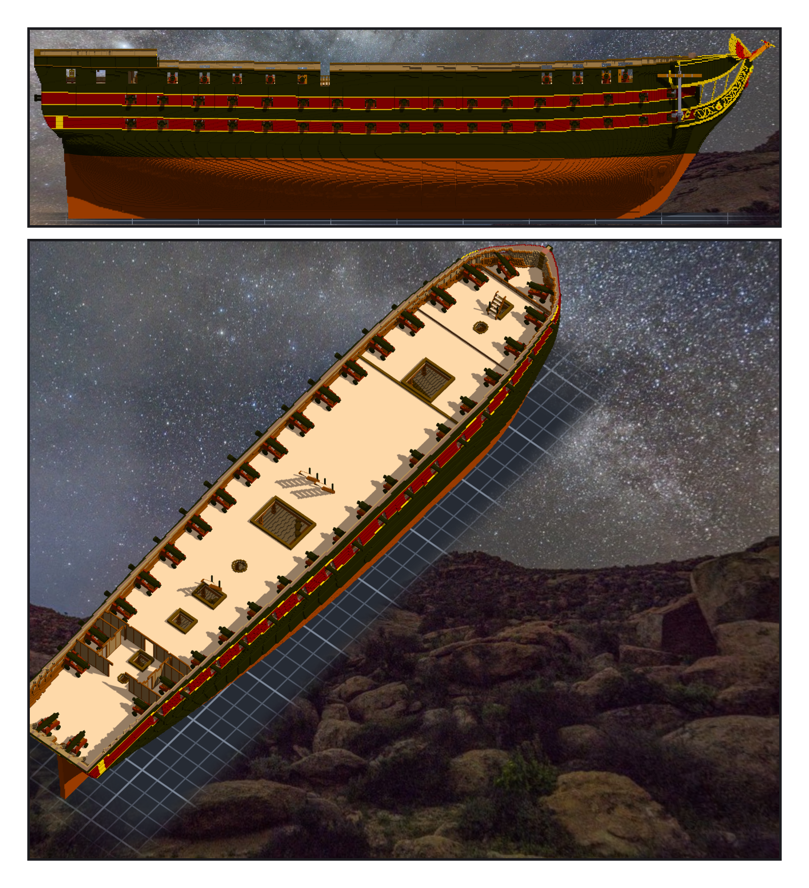
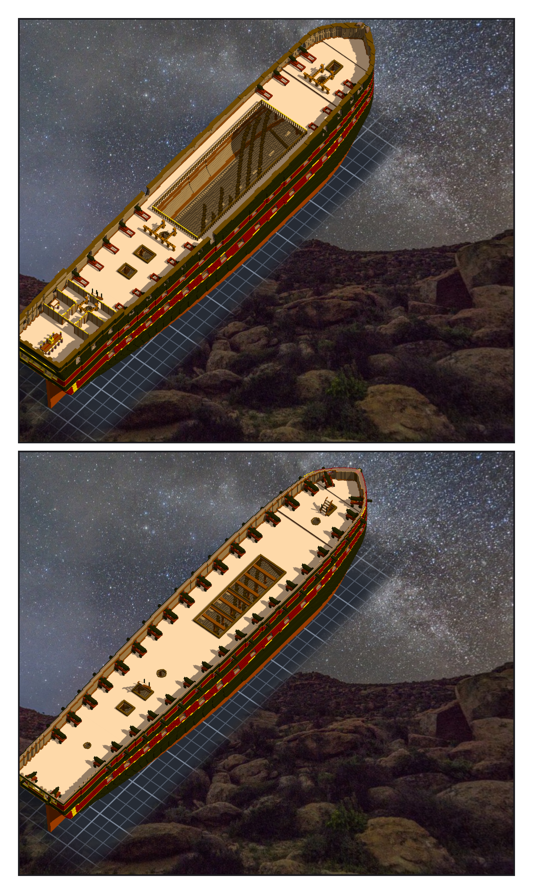

# 第 038 話〈縮在砲門裡〉

## P1 — 九十門

**P1-①**〔正側面：兩條暗紅帶裡兩排砲〕
　字幕：「九十門。下層三十二門三十二磅長砲 —— 新做一門，十八磅那門照口徑放大；上層三十二門二十四磅、上甲板十八門 carronade、船頭船尾八門十八磅追擊砲，都是憲法號那一件，當模型掛上去。」
　字幕：「砲門從船殼量：每舷十七、十七、十二。上甲板前三個在船長室裡，空著。」

**P1-②**〔下層砲甲板〕
　字幕：「每一門從舷牆外面往裡退，半格半格退，退到每一格都不撞。另一舷 mirror=y，四十五對，兩舷逐對對稱。」

---

## P2 — 三個錯，和沒伸出去的

**P2-①**〔上甲板的 carronade〕
　字幕：「量出來的三個錯。二十四磅那件的 pivot 在砲尾 —— 第一輪有幾門整門浮在船外。P 舷取甲板高的那一欄多往裡一格 —— 甲板讀低一格。搜尋先求砲口伸得出去 —— 十六門 carronade 浮起來一格。」

**P2-②**〔上層砲甲板〕
　字幕：「沒伸出去的，照實留著：下層船頭那一對縮在砲門裡三點四九格 —— 要斜到三十五度才伸得出去，那得浮起來一格；下層船尾那一對被船尾的內板夾住，縮二點零二。」
　字幕：「Tim：『測試ok 單層提交吧 然後繼續』。」
