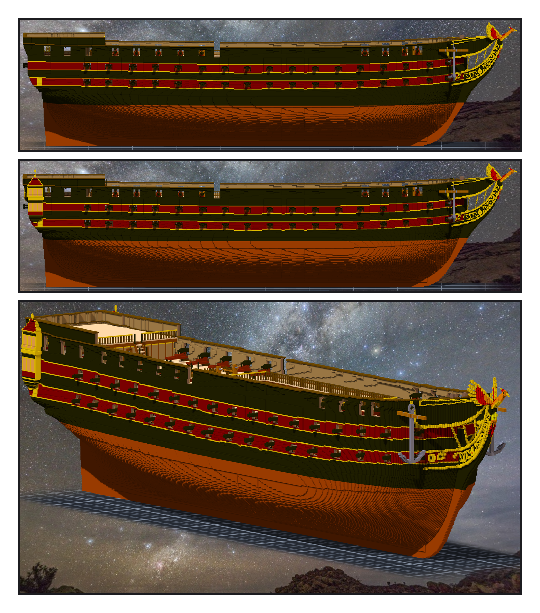
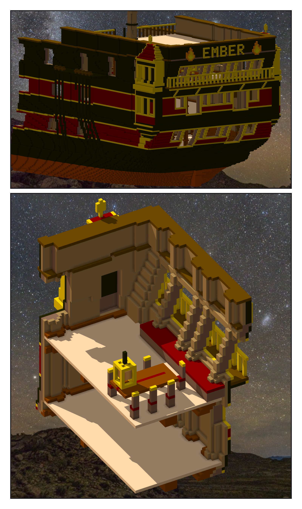

# 第 039 話〈往上塗八層〉

## P1 — 水線

**P1-①**〔之前〕
　字幕：「Tim：『另外我在想 船變高了 船底水線是否也要往上一點(用噴漆模式往上噴塗?)』。銅是外板最外面一兩格，一直照憲法號塗到 z 六十二。」

**P1-②**〔之後〕
　字幕：「往上八格。多一層砲甲板、長了六十六格，吃水該更深；下層砲門下緣離水面，二點六公尺變一點八。」
　字幕：「沒用噴漆 —— 用換色清單，結果帳才對得了逐格。船殼一萬九千一百八十格，knee 一百五十格。」

**P1-③**〔船頭斜前方〕
　字幕：「Tim：『測試ok 單層提交吧 然後繼續(另外窗戶部分可以直接開孔 這樣可以看到內部結構)』。」

---

## P2 — 一塊實心的黑

**P2-①**〔船尾斜後方〕
　字幕：「船尾窗本來就開著。填滿的只有 quarter gallery —— 一層琥珀玻璃，後面是一整塊實心的黑。只拿掉玻璃，看進去還是黑的。」

**P2-②**〔藏掉 poop 甲板，從船長室看〕
　字幕：「玻璃拿掉，上下兩層掏空，背後的船殼各開一道門：下層通上層砲甲板，上層通船長室。第一次只刻了船殼 —— gallery 掏空留下的背牆，還擋在門上。」
