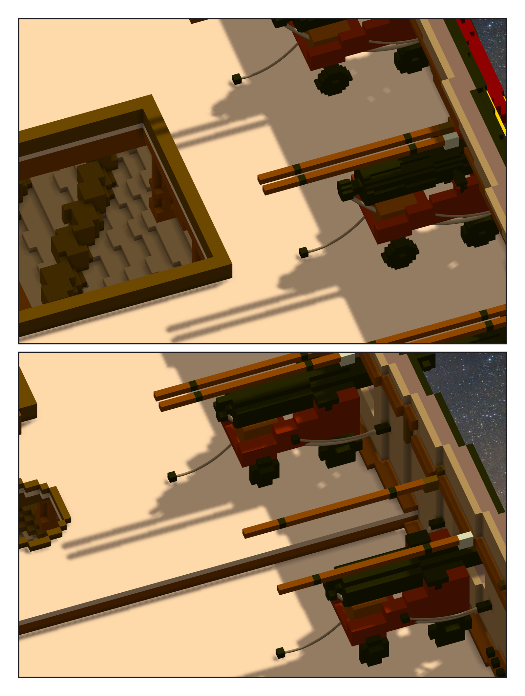
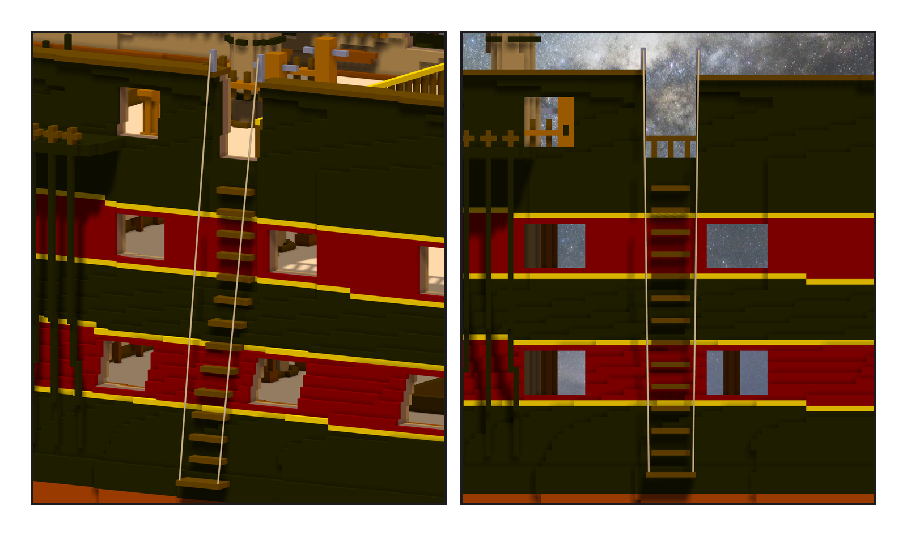

# 第 040 話〈釘在隔牆上〉

## P1 — 三百一十六條繩

**P1-①**〔下層砲甲板〕
　字幕：「每門長砲五條繩：兩條 breeching、兩條 side tackle、一條 train。船牆上的環六十四個，甲板上的三十個；兩門砲之間靠牆的 shot garland 二十六條（有四個空檔放不下）。」
　字幕：「繩會不會穿過東西，要連隔壁的砲一起量 —— 砲是模型，不在格子的匯出裡。」

**P1-②**〔上層砲甲板：rammer 與 sponge 掛在橫樑底下〕
　字幕：「下層第二門在艦長室的側艙裡，船頭那側的環牆上放不下，釘在隔牆朝砲的那一面 —— 憲法號的第二門也是。」
　字幕：「三百一十六條繩。寫入時『無法移除要被取代的檔案』撞了五次，工具自己重試過去。Tim：『這個幫我開成task吧』—— TASK-0534。」

---

## P2 — 十四道

**P2-①②**〔舷梯：斜看／正側面〕
　字幕：「開口本來就在 —— 跟著船身抬上來的；底下兩層留著當門檻。水線抬到七十一之後，踏階從 z 七十四每四格一道到一二六：十四道。憲法號是十道。」
　字幕：「最下一道加寬，man rope 的下端埋在它的兩角。憲法號那時，是 Tim 說了『好像綁在虛空中』之後才這樣做的。」
