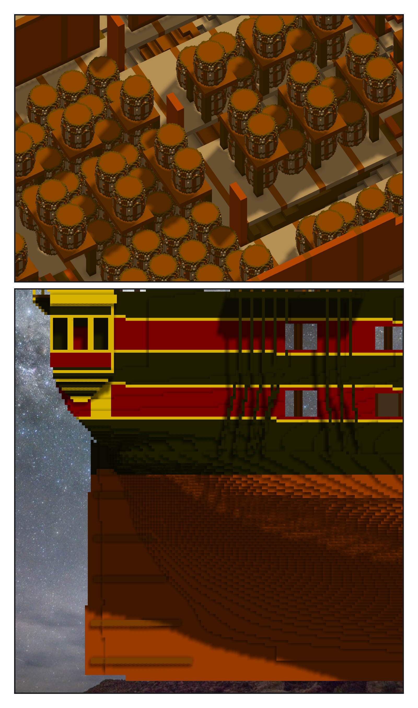
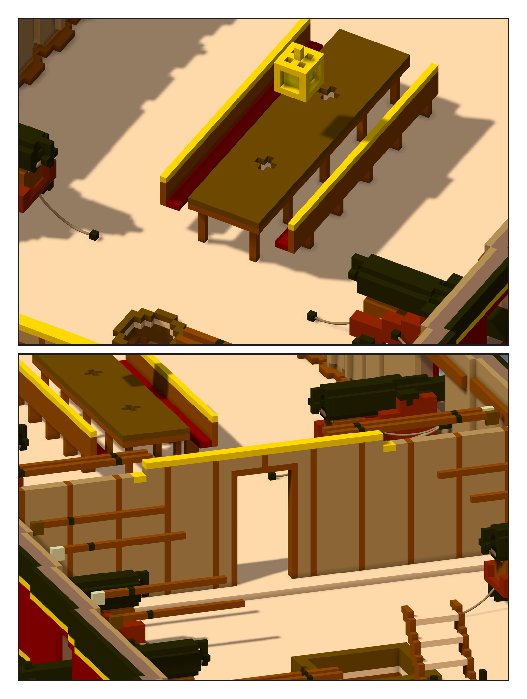

# 第 041 話〈借來的火藥〉

## P1 — 一樣的那一層

**P1-①**〔前彈藥庫〕
　字幕：「彈藥庫在 orlop 底下，那一層兩艘船一樣 —— 不重做，兩間都借憲法號的，一百三十八個火藥桶跟著來。重疊零。」
　字幕：「鏡像差多了一千二百四十七格 —— 正好是那兩間自己的不對稱。後彈藥庫的中心在一五九點五。火藥量還是憲法號的，要不要加，等 Tim。」

**P1-②**〔舵〕
　字幕：「水線那一話記下的：還沒有舵。位置照抄，可是憲法號那件 z 六十三到七十是黑的 —— 複製一份，換二百五十七格銅。」

---

## P2 — 軍官室

**P2-①**〔長桌與長椅（藏掉上甲板，所以穿過桌面的支柱看不到）〕
　字幕：「Tim：『接著繼續吧 GO』。上層砲甲板的船尾，gallery 下層那道門通進來。長桌、長椅、一盞小的餘燼之心；上甲板的支柱從桌面穿過。」

**P2-②**〔前艙壁與門〕
　字幕：「第一版浮空四百七十一格：艙壁長到上甲板上面、椅背只碰到斜角、燈籠頂是空的 —— 最後那個，船長室的第一版也一樣。」
　字幕：「一百八十一萬八千零六十三格，一塊。Tim：『測試ok 單層提交吧 然後繼續GO』—— 然後：『等等 不用繼續 先告一段落』。」
