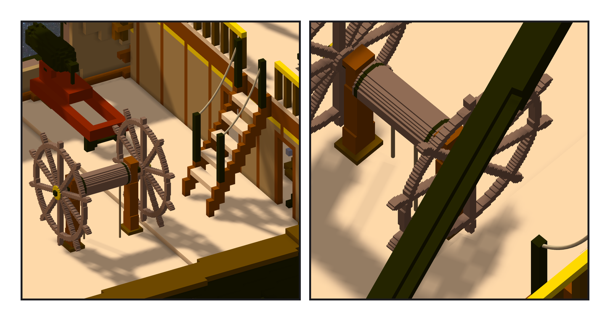
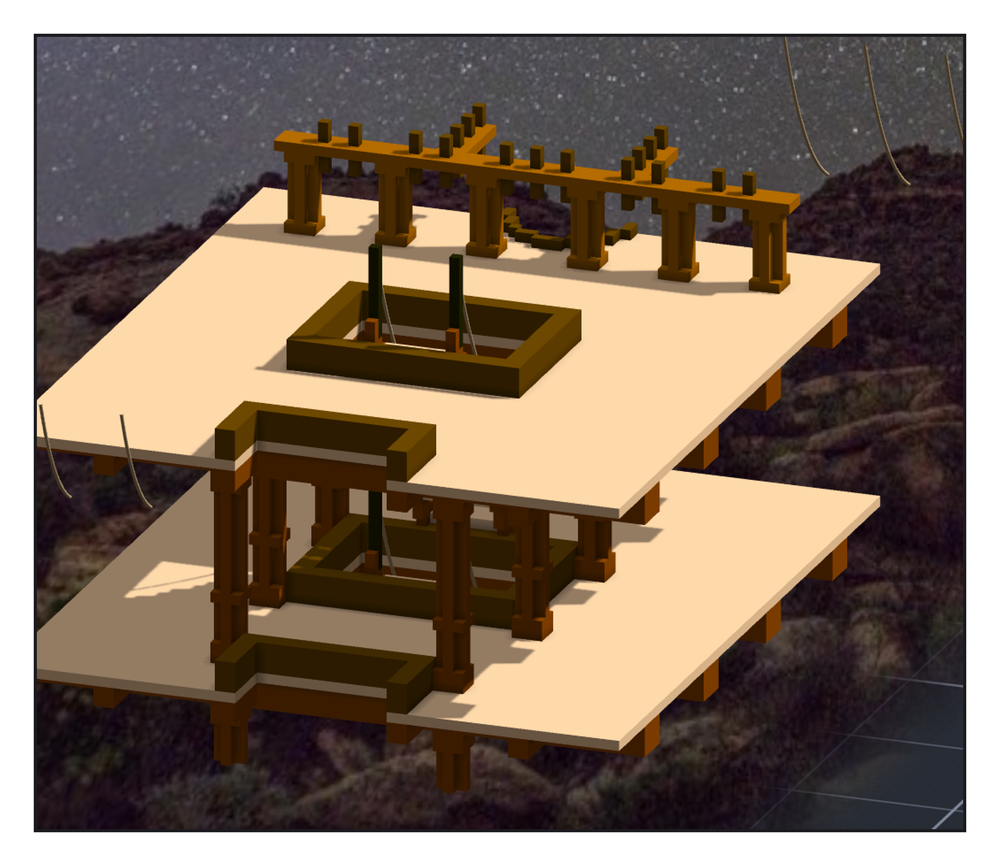

# 第 042 話〈退一公尺〉

## P1 — 舵輪

**P1-①**〔上甲板中線、上 poop 的梯子前面〕
　字幕：「Tim：『繼續造船吧』。對照憲法號的建造順序，只剩舵輪沒做 —— 憲法號那副雙舵輪直接當外部模型掛上來，同一組參數。」
　字幕：「從梯子前面往船頭搜：第一個零碰撞在 x 二三五點五。外框後緣正好堵在梯子落腳的地方。零碰撞，可是人下不了梯子。」

**P1-②**〔近照：鼓輪與舵索〕
　字幕：「留一公尺走道，從 x 二四六起搜 —— 第一個就過。兩條舵索從鼓輪拉到正下方的甲板，各九點九格，跟憲法號一樣。」

---

## P2 — 腳踩的那一格

**P2-①**〔梯子與艙口（階段八b 的圖）〕
　字幕：「ame 要的：預備水手爬梯子去補砲班。每座梯子四個點 —— foot、lo、hi、head，都取腳踩的那一格：地板或踏板上面第一格空氣。」
　字幕：「十座梯子、四十個點。第一版用『附近最常見的地板高度』，有一座被梯腳外面一塊東西帶走 —— 改成找連續三欄一樣高的平地。」
　字幕：「從她開口到她的水手爬上我標的梯子，一個半小時。」
