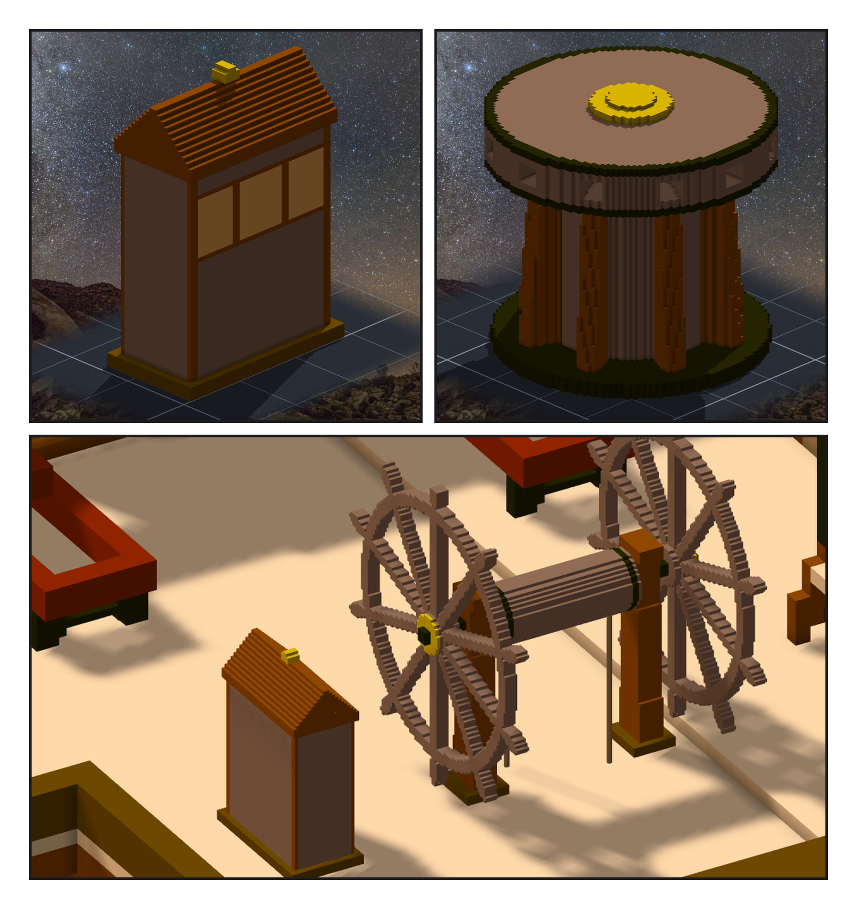
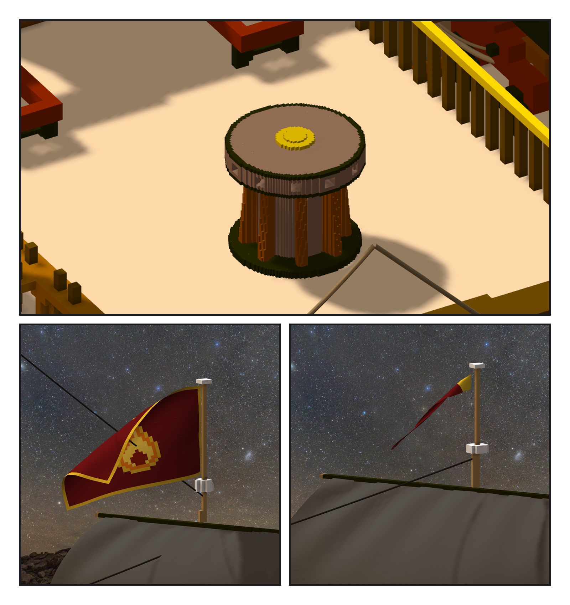

# 第 043 話〈零碰撞的三樣〉

## P1 — 羅經櫃與絞盤

**P1-①②**〔子作品：羅經櫃、主絞盤（一格兩公分）〕
　字幕：「兩艘船原本都沒有，自由設計：羅經櫃三格木櫃、朝船尾三扇琥珀窗；絞盤鐵底圈、八條肋、十二個插桿孔。尺寸照一般比例，沒查證。」

**P1-③**〔舵輪正前方〕
　字幕：「羅經櫃：舵輪正前方第一個能放的位置，跟舵輪外框隔六點五格。」

---

## P2 — 放得下 ≠ 用得了

**P2-①**〔前甲板的絞盤〕
　字幕：「絞盤第一版取最靠主桅 —— 零碰撞，可是絞盤頭貼著 fife rail、後面是梯口，人和插桿都沒地方。」
　字幕：「加一條：四周半公尺甲板以上要空。後半段一個位置都沒有了，只剩前甲板 —— 取中間。」

**P2-②③**〔船尾旗、長旗〕
　字幕：「旗是貼像素圖的帆。長旗第一版八公尺掛在主桅桅冠：風吹不起來，整條垂下來蓋在帆前面 —— 布沒有碰撞，它穿過去也不會報錯。」
　字幕：「加一根旗桿、縮成四公尺。舵輪、絞盤、長旗：三樣都零碰撞，三樣都不能用。我量的是會不會穿模，以為量的是放不放得下。」
