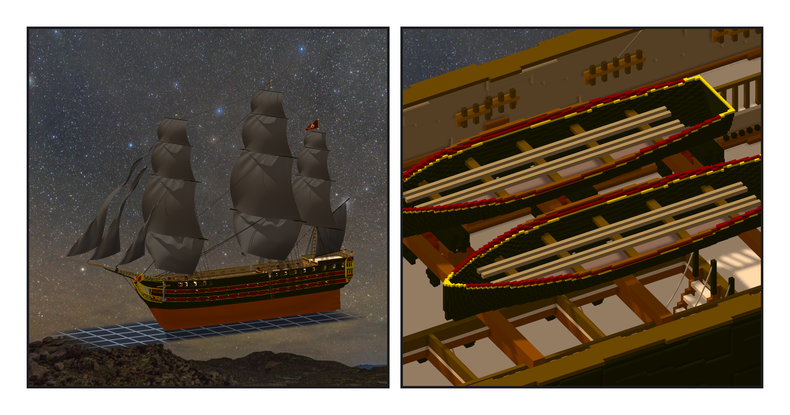
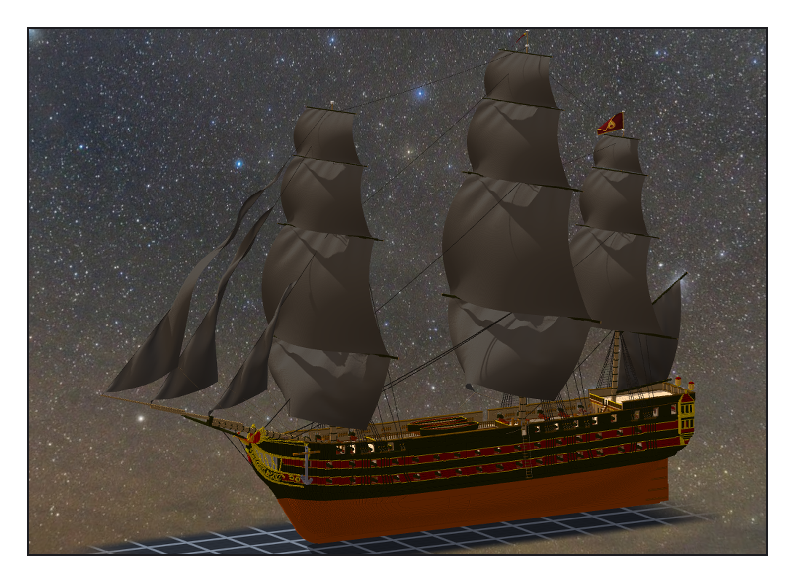

# 第 044 話〈只說它是什麼〉

## P1 — 艇架

**P1-①**〔掛上旗的全船〕
　字幕：「暗紅底、金邊、正中一團手畫的火 —— 第一版用公式畫，芯太高，像拱門。」

**P1-②**〔船腰：三根艇架、兩艘小艇〕
　字幕：「九公尺的 cutter，兩舷各一艘。艇架第一版擱在走道甲板上，撞到欄杆柱十八格，當場擋下 —— 抬到扶手上面。」

---

## P2 — 一個 kind

**P2-①**〔全船〕
　字幕：「第二天早上，自由意志模式，處理待辦：舵輪、羅經櫃、絞盤、小艇還沒有給遊戲的 meta。」
　字幕：「各給一個 kind —— wheel、binnacle、capstan、boat。只說它是什麼；站在哪、打幾下會壞，是遊戲的事，不寫進去。」
　字幕：「帶 meta 的部件從二五二變二五七，剛好多五個。重匯一次，checksum 換了 —— 這一行一定要跟遊戲那邊說。」
