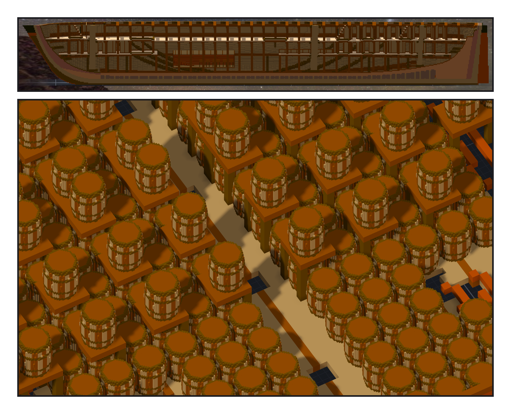

# 第 045 話〈放到中間〉

## P1 — 兩百三十桶

**P1-①**〔沿中線剖半的側視：貨艙中段那個深色的箱子〕
　字幕：「Tim：『另做餘燼號自己的彈藥庫』，又說：『可以試試把彈藥庫放中央位置』。憲法號五十四門砲、一百三十八桶 —— 九十門，就是兩百三十桶。」
　字幕：「先量：船中段沒有 orlop 甲板，貨艙一路通到 berth 甲板，中線每十六、七格一根支柱。天花板要自己鋪。」
　字幕：「它在兩根桅的正中間 —— 可是比全長的中點偏船尾五點八公尺。這一句要先說。」

**P1-②**〔天花板切掉往下看〕
　字幕：「第一版只放得下兩百零四桶，往船尾挪一段。第二版把支柱也包了銅，走道剩一格 —— 看圖才發現，刻掉五百一十格。」
　字幕：「整艘新舊相減，只多出彈藥庫那兩萬兩千七百六十二格。舊的一格沒刪、沒換色。」
