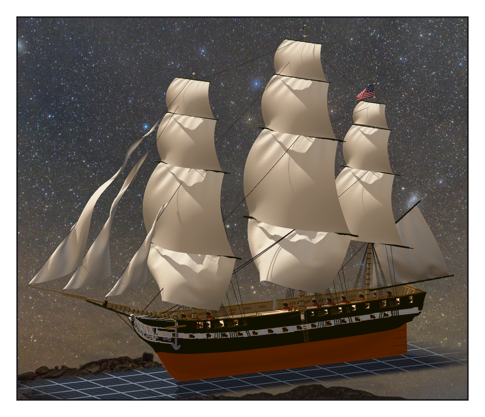

# 第 046 話〈十五顆星〉

## P1 — 往下二十三格

**P1-①**〔掛旗的全船〕
　字幕：「Tim：『是否可以給憲法號也加上旗幟』。餘燼號的索具跟憲法號只差一個平移 —— 桅在 z 一〇九插了二十三格。」
　字幕：「所以旗桿在餘燼號的位置往下二十三格。這是推的；先量本尊：後桅冠頂五一三、主桅六四九，剛好是五三六和六七二減二十三。」

---

## P2 — 數到十三

**P2-①**〔船尾旗〕
　字幕：「一八一二年那場戰爭時用的：十五條紋、十五顆星。產生程式自己數一次，條紋十五、星十五才寫檔。」
　字幕：「第一版數到十三 —— 奇數排第三顆貼著藍角的邊，右臂被裁掉。第二版下面那排的臂貼著紅條紋。四周各留一格藍，才過。」

**P2-②**〔主桅長旗〕
　字幕：「長旗：靠桅藍底白星、上紅下白。一八一二年長旗的星數與條紋，我沒查到 —— 照一般樣式畫，寫在筆記裡。」
