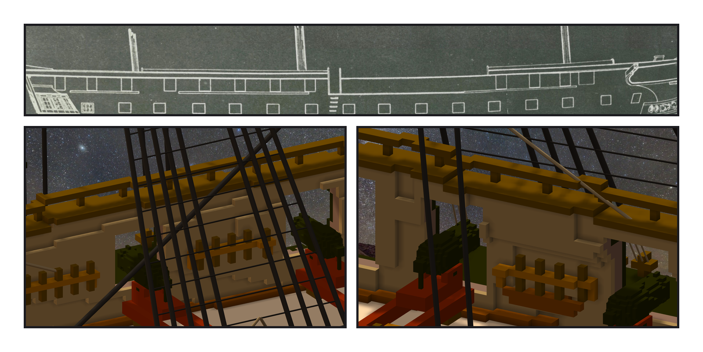
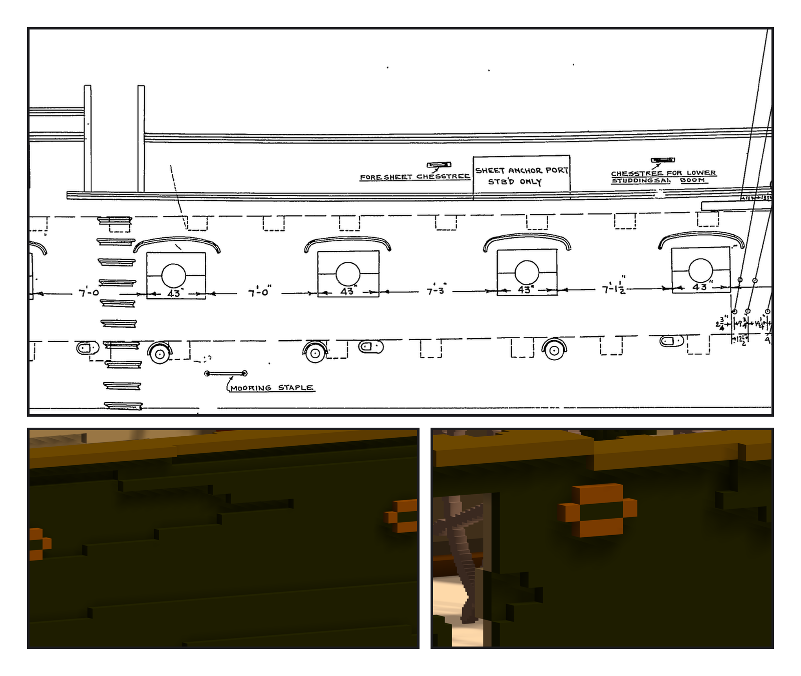

# 第 047 話〈只加不刻〉

## P1 — 上面那一道

**P1-①**〔一九二七年 11 號 sheer plan：舷牆那一條〕
　字幕：「todo 上寫：quarterdeck 那段欄杆比 waist 高。回去量圖：quarterdeck 三道線、waist 一道、entry port 兩根柱子是分界。」
　字幕：「再量作品 —— quarterdeck 的舷頂跟圖一樣高。缺的不是舷頂，是上面那一道欄杆。」

**P1-②③**〔quarterdeck、forecastle 的新欄杆（關帆）〕
　字幕：「只加，不刻：舷頂上三格一道欄杆、每八格一根柱，跟著舷弧一欄一欄升降。程式撞到 entry port 的開口自己停 —— 圖上的柱子在三七二點七。」
　字幕：「作品的 waist 比圖高三點五格。上面站著 pin rails 和繩 —— 不往下刻，照實記。」

---

## P2 — 第五張圖

**P2-①**〔一九三一年 plan 24474：船腰的兩個 chesstree〕
　字幕：「fenders 和 chesstree：手上四張圖都沒畫。派人去查，找到第五張 —— 一九三一年修復時的外部配件圖。」
　字幕：「fenders：一九三一年的舷側沒有，不做。chesstree 三個，橫的圓頭小滑輪板 —— 不是英國船那種直木條。」

**P2-②③**〔作品：船腰兩個、船尾一個〕
　字幕：「兩張圖不是同一年畫的，砲門對不太齊 —— 用砲門當尺換算。船尾那個用兩種尺量，差六格，取中間。」
