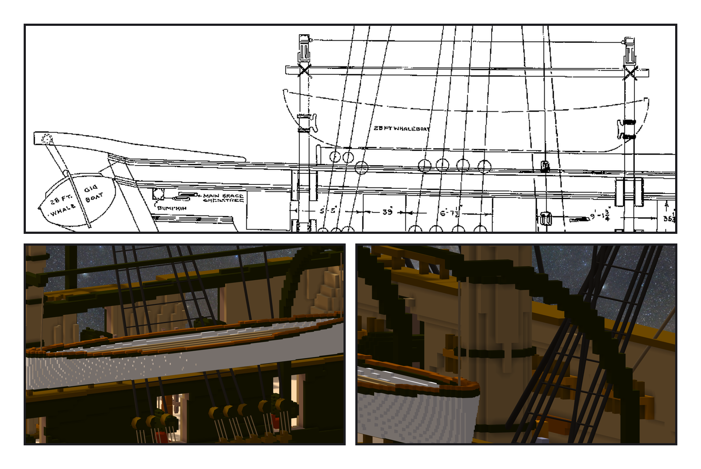
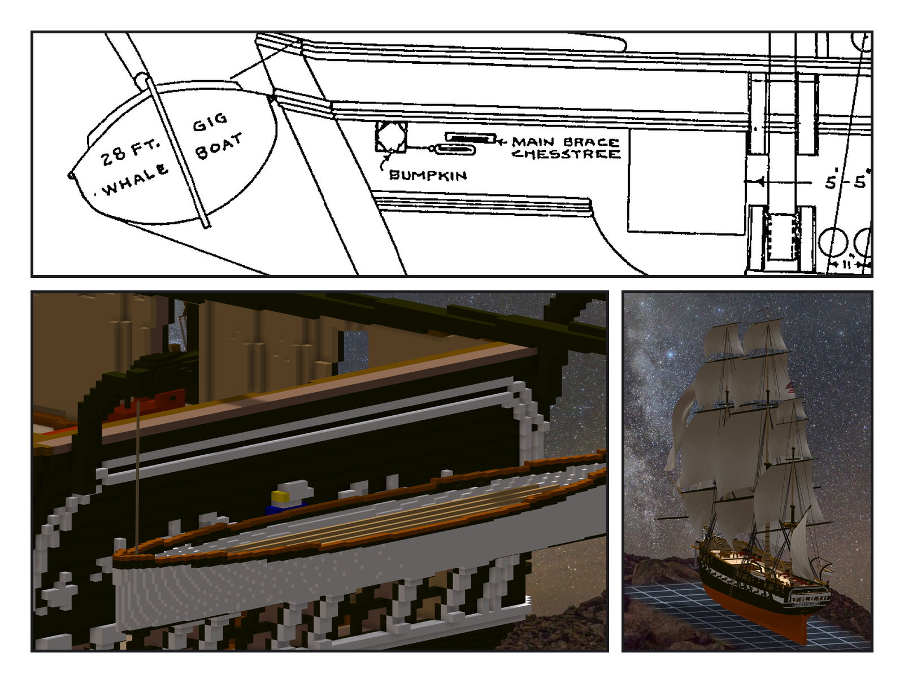

# 第 048 話〈吊在外面〉

## P1 — 挪一公尺

**P1-①**〔plan 24474：quarter davits 與 28 FT WHALEBOAT〕
　字幕：「同一張圖：兩根直立的 davit、頂上一根橫桁、中間吊一艘二十八呎的 whaleboat。davit 頂比舷頂高三十二格，艇底高六格。」

**P1-②③**〔從船外看、艇端與吊索〕
　字幕：「照圖換算，船尾那根 davit 正壓在 mizzen backstay 的 deadeye 上 —— 兩根一起往船尾挪一公尺，間距照圖。」
　字幕：「這一段的繩全在 y 二一八以內，船殼最外二一九。艇放在二二二外面。殼第一版一格厚，斜的地方散成三十塊 —— 改兩格。」

---

## P2 — 橫著吊

**P2-①**〔plan 24474：船尾的 28 FT WHALE GIG BOAT〕
　字幕：「船尾那艘畫成一個橢圓，一點九公尺寬、一點二公尺高 —— 那是艇的橫切面。所以它是橫著吊在船尾後面的。」

**P2-②**〔船尾 gig 近照〕
　字幕：「同一件 whaleboat 轉九十度，吊在 spanker boom 下面。轉的方向是推的 —— 套完讀回引擎算的外框，跟產生程式逐位一樣。」
　字幕：「davit 第一版太矮：柱子還沒碰到欄杆就彎出去了，浮空，程式擋下。抬高四格。」

**P2-③**〔全船從船尾看〕
　字幕：「gig 擋住船尾上半的鷹與星。一九三一年就是這樣吊的 —— 照圖。」
