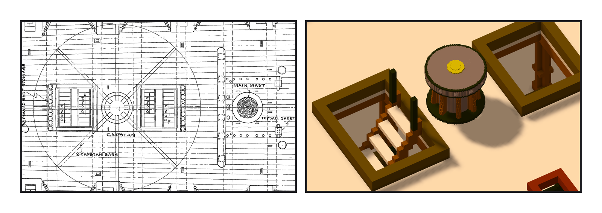
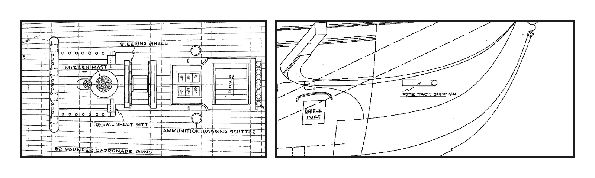

# 第 049 話〈兩個艙口中間〉

## P1 — 剛好就在那裡

**P1-①**〔一九三一年 spar deck 配置圖 #24422〕
　字幕：「CAPSTAN —— 八根絞盤桿。在主桅的船尾側，夾在兩個 DOWN 艙口中間。」

**P1-②**〔作品（關帆、關繩）〕
　字幕：「主桅中心三四九點五，往船尾十七呎半，是二九六點五。作品的 spar deck 在那裡左右各一個艙口，中間是實心的甲板 —— 跟圖同一個樣子。」
　字幕：「絞盤借餘燼號那件，照圖上四呎的絞盤頭縮小。碰撞零，腳下一百二十欄全是甲板。」

---

## P2 — 沒做的兩件

**P2-①**〔#24422：舵輪在 mizzen 的船頭側〕
　字幕：「同一張圖：舵輪在 mizzen 的船頭側。作品的在船尾側，跟圖相反 —— 這次不動，問 Tim。」

**P2-②**〔plan 24474：FORE TACK BUMPKIN〕
　字幕：「bumpkin 換算過去：船頭那根在艏柱前面，側面圖讀不出離中線多遠；船尾那根落在作品第一個砲門的開口裡。作品也還沒有 brace 繩可以接。」
　字幕：「位置要猜、做了沒用 —— 不做，理由寫進筆記。」
