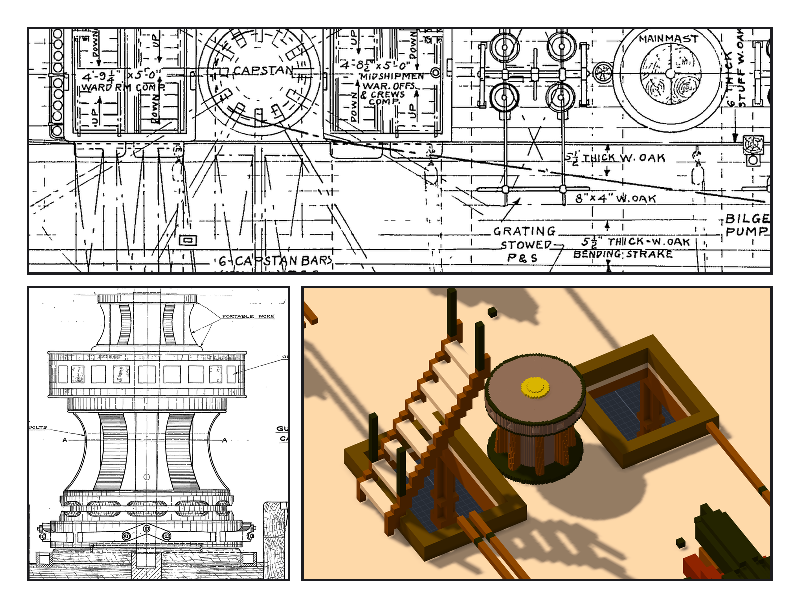
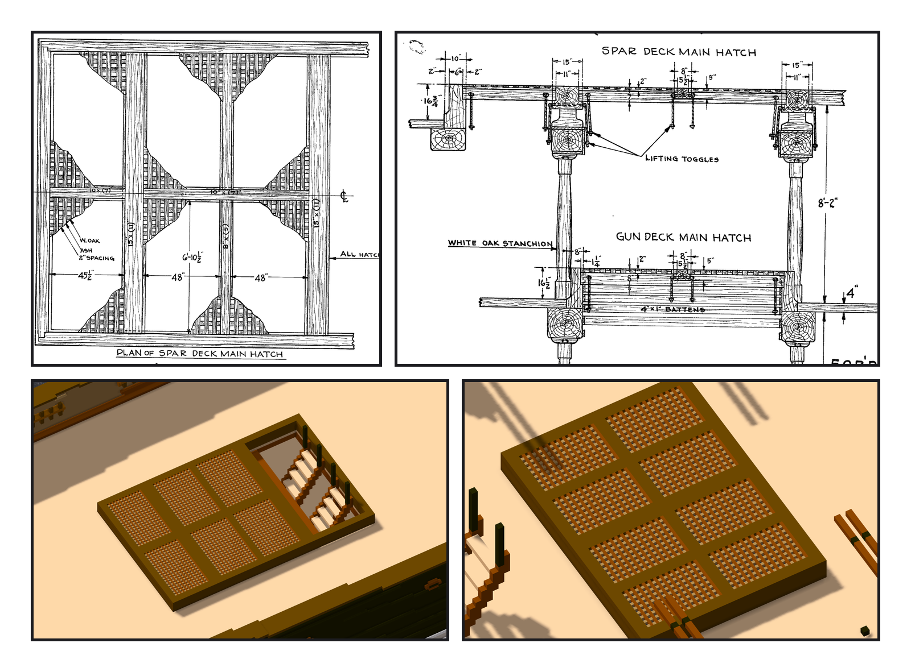

# 第 050 話〈收起來的〉

## P1 — 同一根軸，下一層

**P1-①**〔一九三一年 gun deck 配置圖 #24423〕
　字幕：「CAPSTAN 夾在兩個梯子艙口中間。兩舷寫著：絞盤桿收著、格柵收著（STOWED）。」
　字幕：「作品 gun deck 的同一個位置，前後各一個艙口、中間十七格實心甲板 —— 本來就是這個樣子。」

**P1-②**〔一九二九年絞盤圖 #29621 第 2 頁：GUN DECK CAPSTAN〕
　字幕：「絞盤頭在上面，十二根桿的孔；上面還有一截可以拆的。圖上寫著：這是照一九二七年修復之前的舊絞盤畫的。」

**P1-③**〔作品：只開 gun deck〕
　字幕：「餘燼號那件絞盤本來就是十二孔、絞盤頭在上。縮到絞盤頭五十六吋，掛在 gun deck 上。碰撞零，腳下一百六十六欄全是甲板。」

---

## P2 — 兩吋的條、兩吋的空

**P2-①**〔一九三〇年艙口圖 #19274：spar deck main hatch 平面〕
　字幕：「W. OAK、ASH、2" SPACING。一格十公分是四吋 —— 畫不出兩吋。」

**P2-②**〔#19274：main hatch 立面〕
　字幕：「格柵頂比甲板高十六又四分之三吋（gun deck 十六吋半），格柵兩吋厚。」

**P2-③**〔作品：spar deck 船腰〕
　字幕：「格柵改成一格五公分的子作品：一格條、一格空。船尾那一段站著兩座梯子，不鋪。」
　字幕：「一九三一年的船腰是整片鋪板；作品的是一八四九年的長開口 —— 沒改，只鋪現有的開口。」

**P2-④**〔作品：gun deck main hatch〕
　字幕：「gun deck 只鋪 main hatch；別的艙口，圖上說格柵收起來了。」
