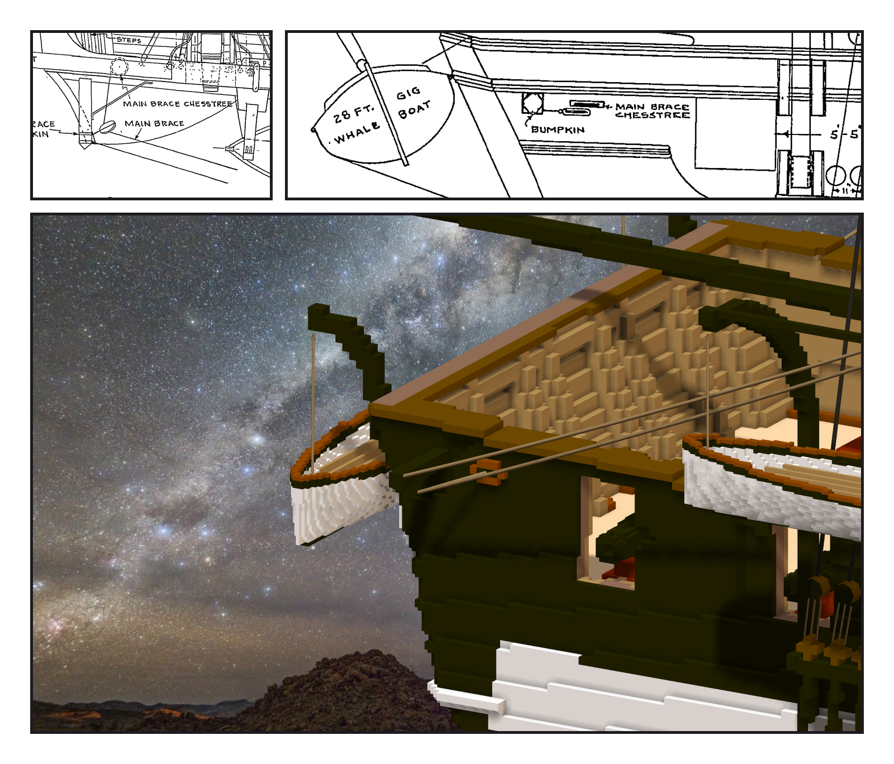
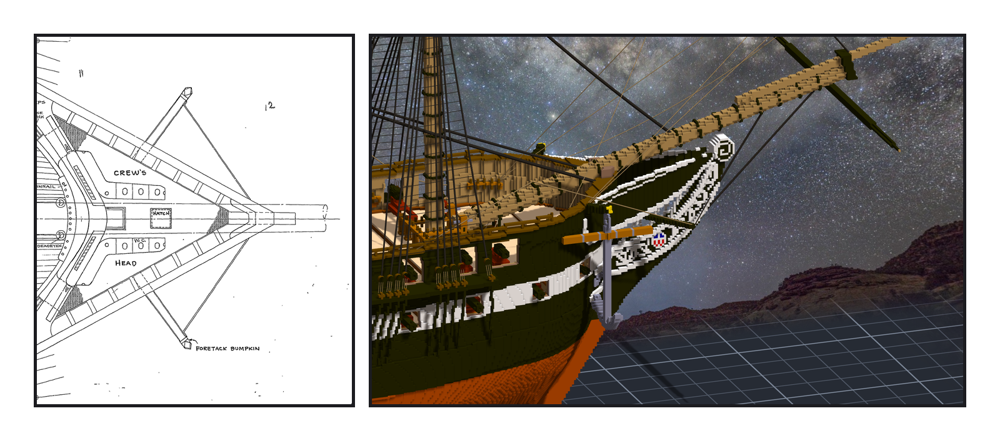

# 第 051 話〈砲門的哪一邊〉

## P1 — 一四三和一一五

**P1-①**〔一九三一年 spar deck 平面圖 #24422：右舷船尾 quarter〕
　字幕：「MAIN BRACE BUMPKIN、端頭的滑車、MAIN BRACE、MAIN BRACE CHESSTREE。用桅當尺換到作品：bumpkin 一〇八、chesstree 一一五。」

**P1-②**〔側面圖 #24474（第 048 話用過的那一塊）〕
　字幕：「BUMPKIN、MAIN BRACE CHESSTREE 都在砲門的船尾側。拿那個砲門當尺：chesstree 一一四點八。」
　字幕：「第 047 話我放的 chesstree 在一四三 —— 砲門的船頭側。兩張圖都說另一邊。刻掉十一格，搬過去。」

**P1-③**〔作品：右舷看船尾〕
　字幕：「橡木色的 chesstree 在砲門後面，再往後一根黑色的 bumpkin。兩條 main brace 往上拉向主桅的帆桁。」

---

## P2 — 船頭那根

**P2-①**〔#24422：head 的 FORETACK BUMPKIN〕
　字幕：「兩舷各一根，從 head rails 底下斜著伸出去，端頭一條 guy 拉回中線。往前十五、往外十九點五格。」

**P2-②**〔作品：右舷船頭〕
　字幕：「作品的 head rail 比圖窄 —— 方向和長度照圖，穿過的那一點對齊作品自己的 rail。小到要找：盾徽右上方、白色 rail 底下那根黑色的斜桿；淡色的繩（tack）停在它的尖上，黑色的細線（guy）從尖拉回 knee。」
　字幕：「上風那一舷的 fore tack 拉到它的尖上。slack 照舊用零點八，把整面 fore course 拉成漏斗 —— 改成一。」
