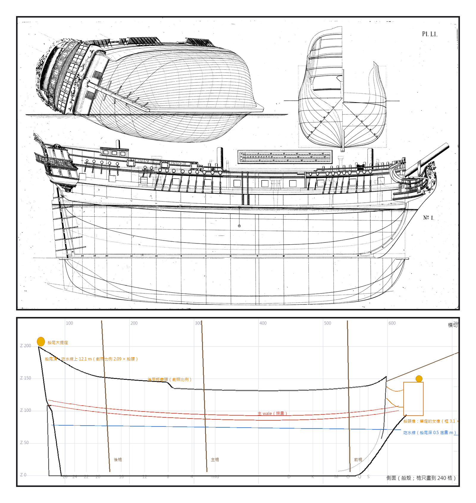
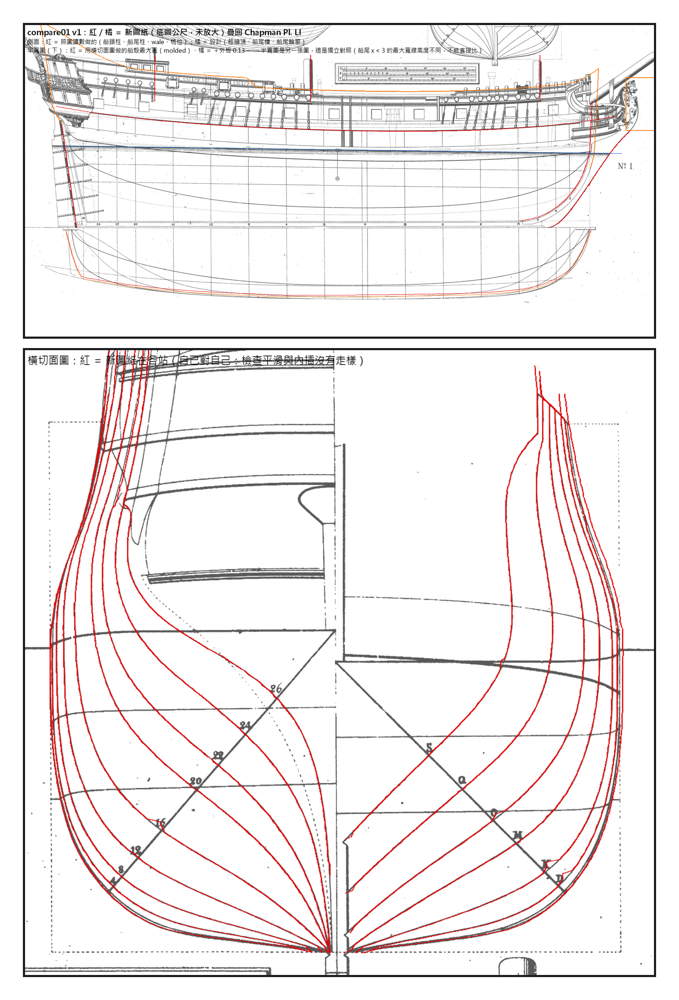

# 第 052 話〈一張圖版〉

## P1 — 照一艘同類的船

**P1-①**〔Chapman《Architectura Navalis Mercatoria》1768，Pl. LI：英國東印度商船（Public Domain Mark）〕
　字幕：「Tim：『那有興趣造加勒比海盜的 黑珍珠號嗎』……『然後圖紙可以參考同類船隻的 在由妳重新設計(外型風格貼近黑珍珠)』。」
　字幕：「電影裡的船沒有圖紙。能照的，是一艘同一類的船。一萬兩千一百一十二乘八千八百像素；圖上的比例尺有三排（瑞典呎、英呎、法呎），換成每公尺二一九點四像素，互差百分之零點六以內。」

**P1-②**〔新圖紙 01 線形圖 v1：側面〕
　字幕：「黑是照圖讀的，橘是我設計的。船尾頂加高到船腰的二點零九倍、後甲板的盡頭 —— 看劇照取的比例，只用跟單位無關的那幾個。」
　字幕：「整艘一起放大，放到寬度碰到史上最大那一級（四十三呎九吋）：一點二八五二倍。兩垂標間五十點四公尺。」

---

## P2 — 疊回去

**P2-①**〔compare01：新圖紙疊回 Pl. LI 的側面與半寬圖〕
　字幕：「第一次疊，紅線在船頭往前衝出去兩公尺多。我先懷疑讀數；重追，還是同一條線 —— 那是船頭柱、gripe、knee 連成的一條外緣。錯的是我的程式拿它去推 rabbet。」
　字幕：「下半是半寬圖：用橫切面圖做的船殼，最大寬疊回另一張圖，從船尾貼到船頭。」

**P2-②**〔compare01：橫切面圖〕
　字幕：「疊回橫切面圖一定會對 —— 那是自己對自己，只能看平不平滑。」
　字幕：「同一輪還抓到：船尾柱的斜度只用了三列（重擬合三百六十三列是八點二四度）、船中那一站在 z 一點三到一點七跳了線、半寬圖內側那條粗線不是水線。數字是真的，住址是我補的。」
