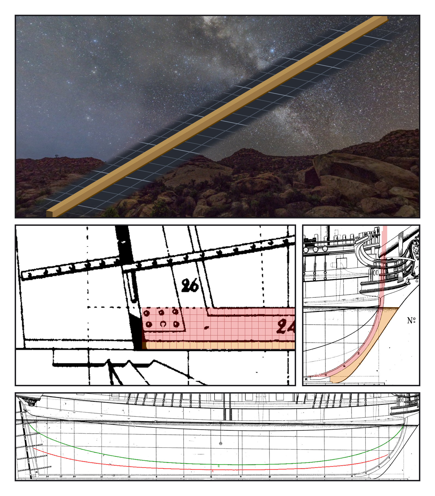
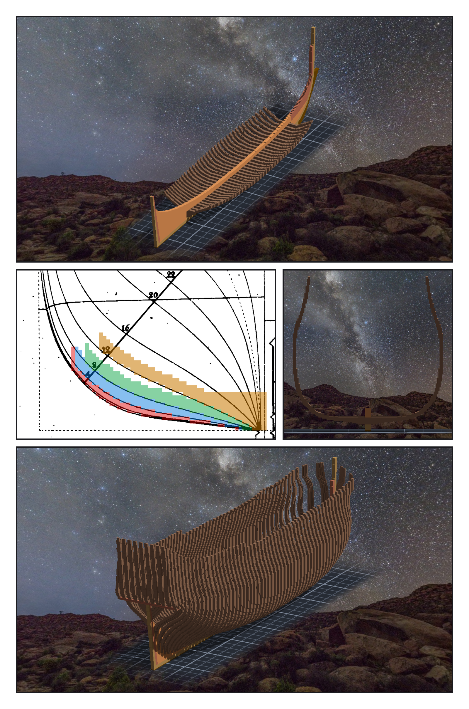

# 第 053 話〈一整副肋骨〉

## P1 — 兩本帳

**P1-①**〔作品：龍骨與護龍骨〕
　字幕：「Tim：『單層提交吧 然後開始下龍骨』。Chapman 的龍骨四點八格、護龍骨一點五格 —— 取五加一，讓龍骨頂面落在整數格。」

**P1-②**〔作品的格換回底圖像素，疊在 Pl. LI 船尾〕
　字幕：「結果帳只證明作品跟清單一樣。清單跟原圖一不一樣，要另一把尺：從原圖的線出發找線心的探針。」
　字幕：「有一根報三點二 —— 那一列的黑帶被舵的鐵件蓋住，探針挑到別的黑段。改的是探針，不是龍骨。」

**P1-③**〔疊在 Pl. LI 船頭：船頭柱與 gripe〕
　字幕：「三條線在吃水線附近收攏：一對細的是 rabbet，中間是船頭柱的前面，外面那條是上一話那條外緣。這一次探針在原圖那一列重新找線心 —— 拿追線去量用追線做的東西，只會永遠同意。」

**P1-④**〔Pl. LI 側面圖：重新追的兩條線〕
　字幕：「舊讀數的『肋底上升線』中段對、兩頭跳到水線上 —— 同一個名字，住在兩條線上。重追，連下面那條虛線一起：A 是 cutting-down line，B 是 keelson 的頂，跟憲法號一樣差半公尺。」

---

## P2 — 從底肋到兩頭

**P2-①**〔作品：底肋三十六片＋keelson〕
　字幕：「船尾的站號就是肋位號：每肋位零點七〇六六公尺。第一片貼上去，迴圈判它不對、停了 —— 實際一千九百六十四格，就是預期；清單檔尾巴多一個 \r。停下是對的，理由是假的。」

**P2-②**〔落在站上的四片底肋疊回橫切面圖〕〔船中那一片肋骨的剖面〕
　字幕：「反向對照：Z 偏三格，keelson 報三、底肋報零；半寬偏三格，反過來。該不動的真的沒動 —— 那才證明探針量的是我以為的那個軸。」
　字幕：「肋骨第一版少連三格。我猜了一個修法，跑完，一格都沒少。猜錯的修法照樣不報錯；格數沒變才是讀數。」

**P2-③**〔作品：階段六之後，三十三萬五千六百八十九格〕
　字幕：「Tim：『單層提交吧 照劇照 然後繼續階段六』。兩頭的肋骨照同一個肋距排到底。第一版三塊 —— counter 的底是平的，我只量了剖面上的點，跳過去的那一段沒有點。改成量到線段。」
