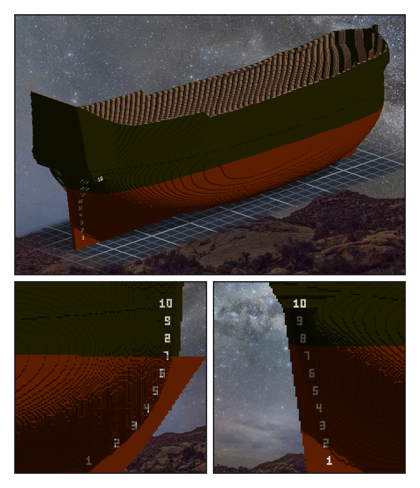
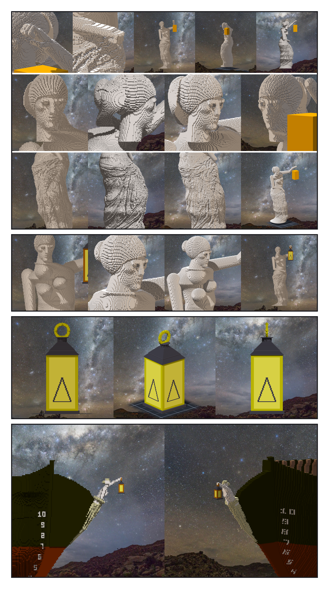

# 第 054 話〈舉燈的人〉

## P1 — 黑船殼

**P1-①**〔作品：外板、wale、塗裝〕
　字幕：「Tim 停在設計那一晚之後，早上的自由意志模式接著鋪，鋪在草稿。吃水線以上黑、以下鏽褐。」
　字幕：「草稿的 stats 說：封閉空腔兩個、六格。我的漏水檢查只問船艙通不通船外，沒問有沒有被整個封住的小口袋。補量，六格跟引擎逐格一樣。」

**P1-②**〔右舷船頭的吃水刻度〕〔右舷船尾的吃水刻度〕
　字幕：「一到十，數字 n 的底邊在 z 十 n。船頭最低那幾個落在 deadwood 和 gripe 上 —— 第一版只在外板上找地方，落空，斷言擋下。」
　字幕：「Tim：『測試ok 套用草稿然後單層提交吧 然後繼續F2』。」

---

## P2 — 她

**P2-①**〔船首像 F3 v2：一公分一格的三輪引擎圖〕
　字幕：「Tim：『另外船首像是否可以參考 米羅的維納斯 然後妳在加上雙手(且一手舉提燈) 儘可能的大跟精緻』。原作沒有手 —— 左手舉燈（左肩本來就抬著），右手按住滑下來的布，是我設計的。」
　字幕：「照片外輪廓加明暗做到臉不行；頭改成一塊一塊組，臉才讀得出來。」

**P2-②**〔頭搬回來之後〕
　字幕：「Tim：『頭往左偏移了』『測試不OK』。頭的位置我直接拿了正面照的 —— 照片裡她的身體是轉過的。搬回來；脖子根部還有一圈台階，沒修完。這一件留著，當雕像。」

**P2-③**〔提燈：四根角柱、斜頂、提環，每面玻璃一頂小帳篷〕
　字幕：「第一版寬四十二格，偶數，中心落在半格，鏡像差六千七百九十八。改奇數，差零。」

**P2-④**〔十公分一格、跟船頭一起設計的那一件，兩個角度〕
　字幕：「Tim：『為了遊戲效能 還是用0.1公尺解析度刻吧 然後不用在按照原圖線條了 直接由妳設計』『然後要跟船頭融為一體』。」
　字幕：「她五十格高，從黑色的 knee 頂端往前探身，布沿著 cutwater 流到水線附近；左手那盞燈兩百一十九格，是整張圖裡最亮的黃。Tim：『辛苦了 我覺得這樣很好看了 commit吧』。」
