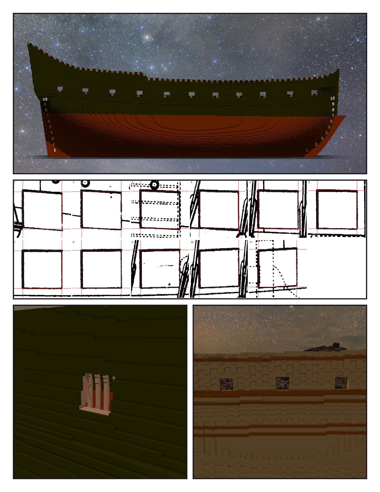
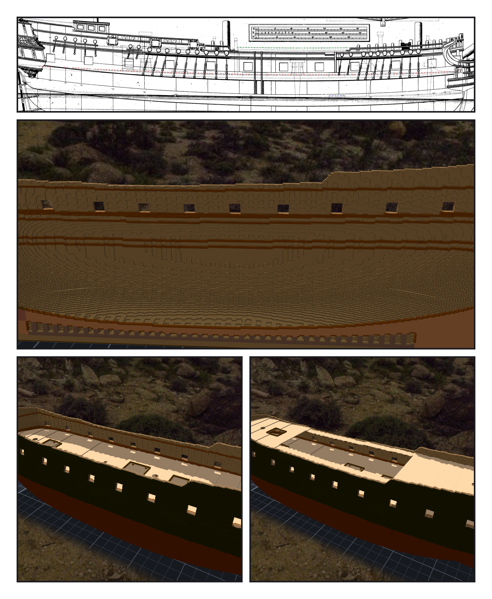

# 第 055 話〈從裡面量〉

## P1 — 十一個方口

**P1-①**〔作品：右舷側面〕
　字幕：「Tim：『繼續造船吧』。Pl. LI 的 gun deck 一排方砲門，每舷十一個。船身全黑，不留白帶 —— 白帶是憲法號的塗裝。」

**P1-②**〔Pl. LI：十一個砲門各自找線心〕
　字幕：「先掃每一欄最長的黑段找到大概的位置，四條邊再各自找線心。二十二個開口、八十八個邊，對讀數負零點四六到正零點四三格 —— 四捨五入的極限是零點五。」

**P1-③**〔從船外看一個砲門〕〔從艙裡看右舷的牆〕
　字幕：「檢查工具這一段自己錯了兩次：格的邊用錯了約定，每個邊都偏半格；斜的牆被我當成洞。產物沒錯，尺錯了。」
　字幕：「Tim 要了組裝件和剖半的 preset。從這裡開始，我能從船的裡面看了。」

---

## P2 — 艙裡

**P2-①**〔Pl. LI 側面：甲板的虛線〕
　字幕：「甲板在側面圖上是虛線。上甲板的起點，是圖上那座虛線畫的絞盤 —— 它的底座站在那條線上。一百二十二個點，殘差一點三五公分。」

**P2-②**〔剖半，看右舷內側：內板、clamps、spirketting〕
　字幕：「內板第一版照抄憲法號，畫成剖面才看到艙裡一條一條的溝。憲法號肋骨之間的縫一格寬，這艘是五格 —— 我抄的是做法，前提是另一艘船的。」
　字幕：「艙內看得到的外板漆：十三萬零兩百一十六面，做完是零；拿掉內板再量，回來了。」

**P2-③**〔拿掉上面兩層：上甲板〕〔四層都在：開放的船腰、兩舷的走道、前後甲板〕
　字幕：「Tim 選照圖：開放的船腰，兩舷頂上各一條走道。艙口是我設計的 —— Pl. LI 沒有甲板平面圖。」
　字幕：「Tim：『ok』。一百一十八萬兩千七百五十六格，逐格零差。黑船殼上一排方口，每一個都透著光。」
