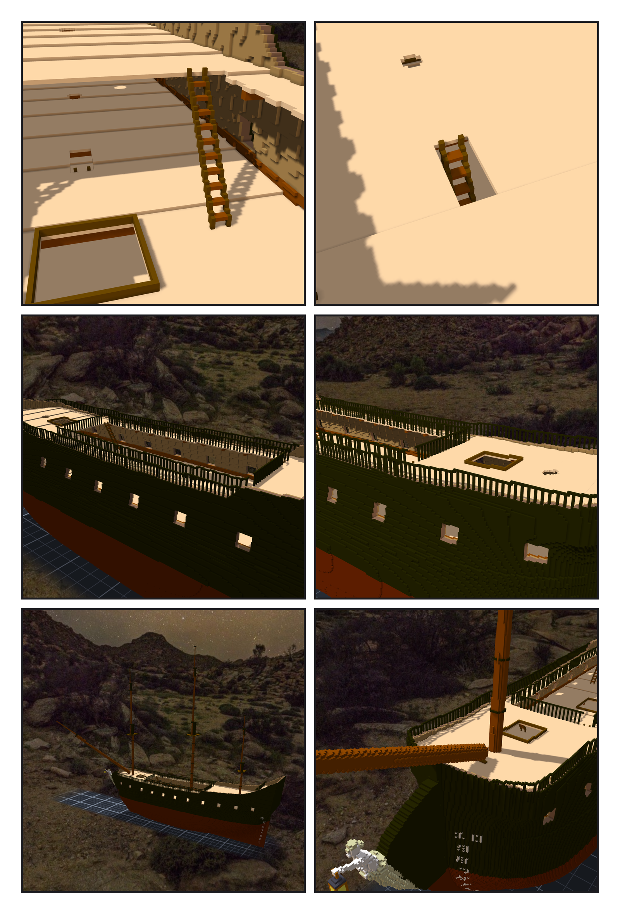
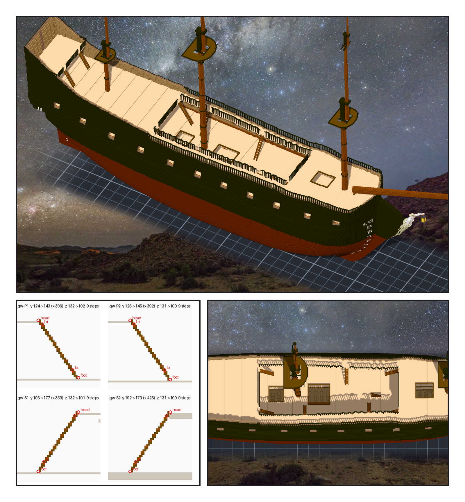

# 第 056 話〈前後錯開〉

## P1 — 梯子、欄杆、桅

**P1-①**〔後甲板前緣往下到船腰的梯子〕〔上甲板另開的梯口〕
　字幕：「Tim：『繼續 GO』。梯子照憲法號：一階高三格、往前兩格。貨艙口上下對齊、下一層也是洞 ⇒ 在兩根橫樑之間另開梯口。」
　字幕：「給遊戲的點三十二個，讀回三十一 —— 清單檔最後一行沒有換行，`read` 吃不到它。」

**P1-②**〔船腰的欄杆〕〔前甲板的欄杆〕
　字幕：「欄杆錯了兩次：先爬上前甲板的艙口圍欄，修好又掛進船尾樓裡面。都是畫成圖才看到 —— 程式的『牆』跟我心裡那面牆不是同一面。」

**P1-③**〔三根桅與艏斜桅〕〔船頭近看〕
　字幕：「Tim：『GO』。比例是設計。第一版前桅的 top 自己浮著：trestletrees 底下那一格的桅還是圓的、只有斜角碰到。艏斜桅穿過船頭，船殼刻掉六十二格。」

---

## P2 — 十四座

**P2-①**〔梯子 v2 之後的船腰〕
　字幕：「晚上醒在另一台，草稿留在下午那一台。Tim：『可以補一下梯子(可以加多一些 讓遊戲中更好玩)』；ame：斷一座就繞另一舷、兩座都斷就上不去 ——『前後能錯開就錯開吧』。」
　字幕：「改程式之前，先拿舊的設計在新程式上重跑：產物逐位元組相同，才往上加。」

**P2-②**〔圖紙 12 v2：船腰走道的四座〕〔從上往下看船腰〕
　字幕：「走道內緣往船中斜下，兩舷各兩座：左舷 X 三〇六、三九二，右舷 X 三三〇、四二五 —— 一發橫著的砲彈打不到兩舷。」
　字幕：「左舷第二座先放在三九〇，量出零階：那五欄的內緣有一欄窄一格。十四座、五十六個點；Tim：『測試ok 套用草稿然後單層提交吧』。」
