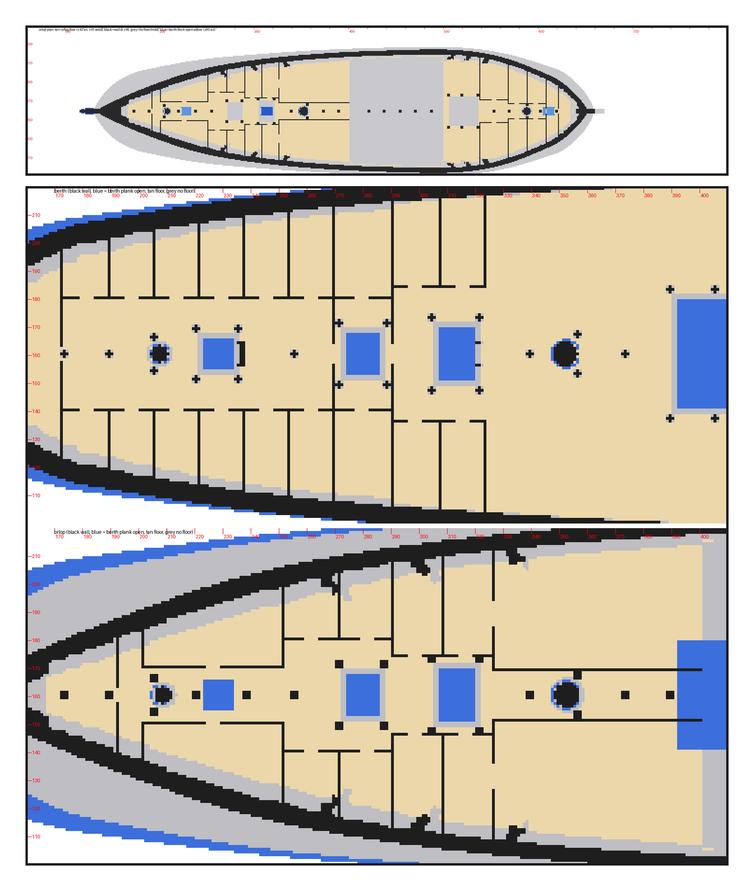
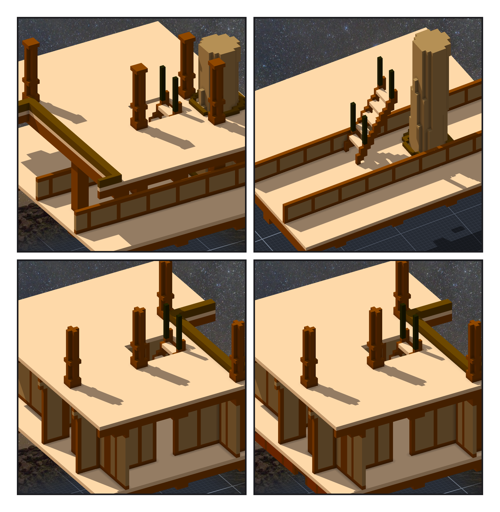

# 第 057 話〈往下一層〉

## P1 — 走不到的那幾間

**P1-①**〔憲法號 orlop 平面（開梯口之前）：淡色是地板、黑是牆、灰是貨艙、藍是上面 berth deck 的開口〕
　字幕：「ame：『orlop 還沒有梯子，那幾間標「走不到」』。量了，是真的沒有 —— 第 020 話裝梯子的時候三處都放不下。Tim：『orlop也補一下』。」
　字幕：「第一張整個船中都是藍的：berth deck 一段一段高度不一樣，我拿一個高度去量開口。」

**P1-②**〔後半段：上是 berth deck、下是 orlop〕
　字幕：「orlop 走道的中線上一排柱子，主桅也在中線 —— companion 那座就是撞到柱子。梯子改放走道靠右舷那一側。」

---

## P2 — 四座梯子

**P2-①**〔憲法號後面那座：從 berth deck 看下去〕〔拿掉上面幾層，從 orlop 看〕
　字幕：「梯口開在 berth deck 兩根橫樑之間，主桅前面。梯子落在兩道艙壁之間的走道上；拿每一間艙房的範圍去對，沒有一格在房間裡。」

**P2-②**〔餘燼號前面那座〕〔憲法號前面那座〕
　字幕：「餘燼號是拉長的憲法號：後面那座同一個位置，前面那座往前挪六十六格。四座都是第一次就放得下。」
　字幕：「Tim：『測試ok 套用草稿然後單層提交吧 然後通知ame』。vxk 重匯：憲法號 2725233c、餘燼號 2ee492c1。」
