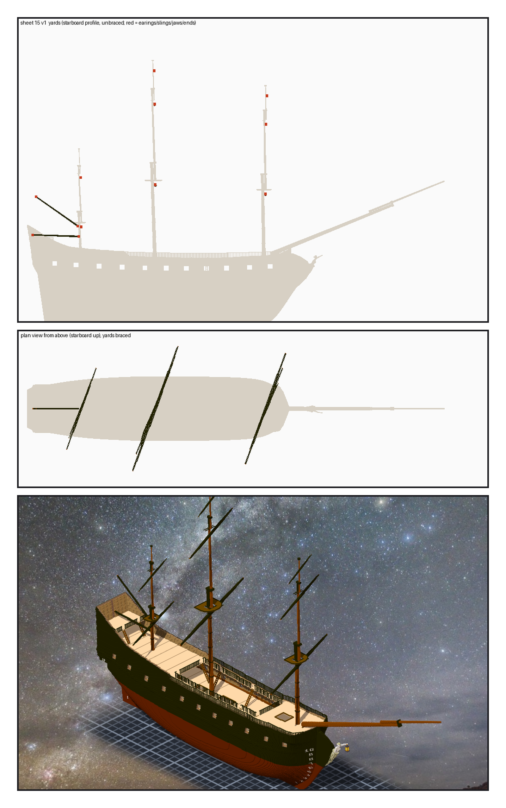
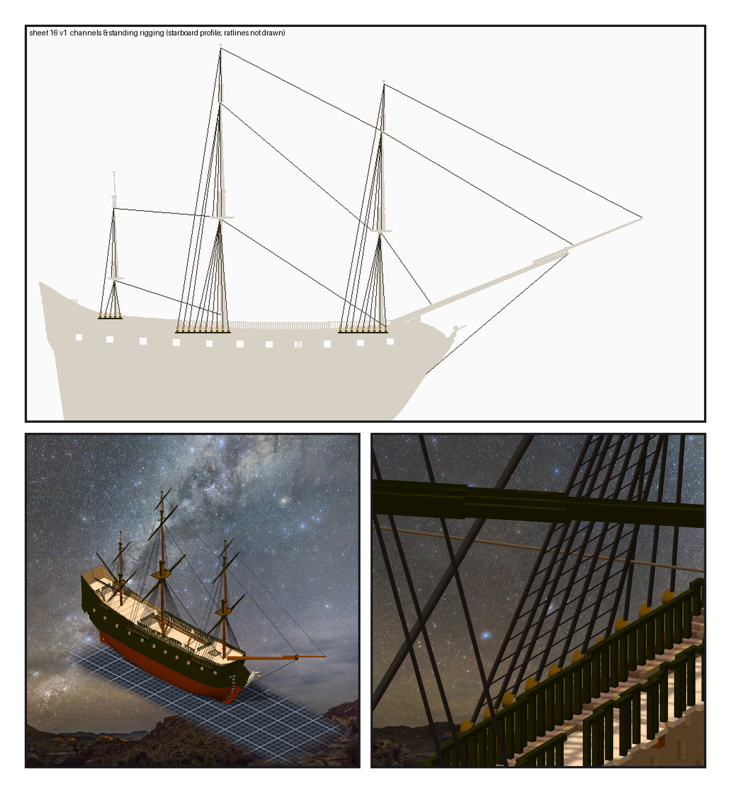

# 第 058 話〈掛在哪一根上〉

## P1 — 帆桁

**P1-①**〔圖紙 15：右舷側面，帆桁還沒轉；紅點是帆角、slings、jaws、末端〕
　字幕：「Tim：『接著繼續造船 直到完成可以匯入遊戲吧』。造船規格寫著：帆桁一開始就是一根一件子作品＋模型 —— 憲法號第 030 話才拆下來的那一課。」
　字幕：「後桅矮：上面是 top（二〇二），下面是船尾樓。boom 一七四、gaff 一九五、三十五度，都是第一個不碰的。兩根的 jaws 只差二十一格。」

**P1-②**〔從上往下看：轉過 brace 的十根〕
　字幕：「右舷那一頭往前：course 二十度、topsail 二十二、topgallant 二十四。轉過之後，每一格的格心和八個角都不在別的格子裡。」

**P1-③**〔星空下，三根桅掛上帆桁〕
　字幕：「二百二十五個固定點，匯出來對程式算的轉過位置：最大差零點零零零七格。」

---

## P2 — 靜索

**P2-①**〔圖紙 16：右舷側面的索具台與靜索（ratlines 不畫）〕
　字幕：「第一版六百一十九條。每條拉直線、每半格取一點：五十四條落在實心裡。後桅的 shrouds 從舷牆裡穿出去 ⇒ 後桅那塊索具台抬到一四五；bobstay 穿過船首像 ⇒ 下端往下找到六十六。」
　字幕：「鏡像那條關聯被擋：框是整艘船那麼大，鏡過去就超出一格。改成只框右舷；同名的關聯記著加上去那一刻的框，要拿掉重加。」

**P2-②**〔掛上靜索的夜燈號〕〔拉近主桅那一舷：上 deadeye 與 ratlines〕
　字幕：「六百零九條，一條一條下，兩分四十二秒。固定點九十三、繩六百零九，讀回差零。」
