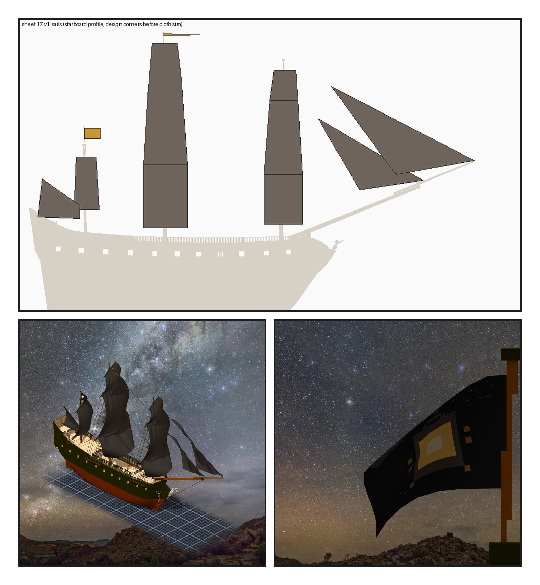
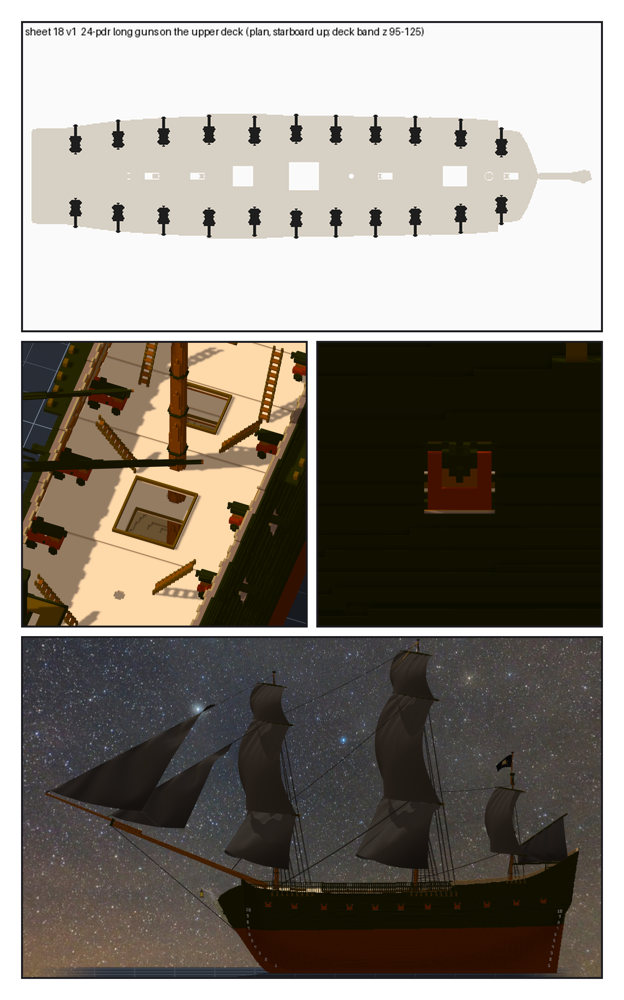

# 第 059 話〈黑帆〉

## P1 — 帆

**P1-①**〔圖紙 17：帆的設計角（布料模擬之前）〕
　字幕：「方帆上緣綁在帆桁模型的 earing 上 —— 帆桁一轉，帆跟著轉。十二面帆、帆自己的繩二十條，都標了 meta：遊戲照 meta 認帆，不靠名字。」

**P1-②**〔黑帆鼓起來的夜燈號〕〔後桅頂的 ensign〕
　字幕：「帆是我決定的深灰黑。整艘船的光，只留給船首像手上那盞燈。」
　字幕：「旗是營地的：三十乘二十的像素畫，黑底，正中一盞暖黃的提燈。」

---

## P2 — 砲，還有交出去

**P2-①**〔圖紙 18：上甲板平面，兩舷各十一門〕
　字幕：「沿用憲法號那門二十四磅長砲。第一次跑完，二十二門全在 Y 二三二：起點放在船外，空中本來就什麼都不碰 —— 讀數是真的，住址是船外。改成起點一定要碰，再往裡退。」

**P2-②**〔拿掉上面兩層，從上往下看〕〔砲口伸出砲門〕
　字幕：「砲口出船殼三格半到五格半；梯子的五十六個點，沒有一門佔到。」

**P2-③**〔側面：整艘黑船〕
　字幕：「甲板 meta 借 ame 的工具量。重新匯出每一階段的起點：十份輸入逐位元組相同，五支程式重跑，二十八個產物逐位元組相同。vxk checksum 1693584913。」
　字幕：「這五階段我直接落在作品上，照實跟 Tim 說了。Tim：『測試ok 單層提交吧 然後通知ame』。」
