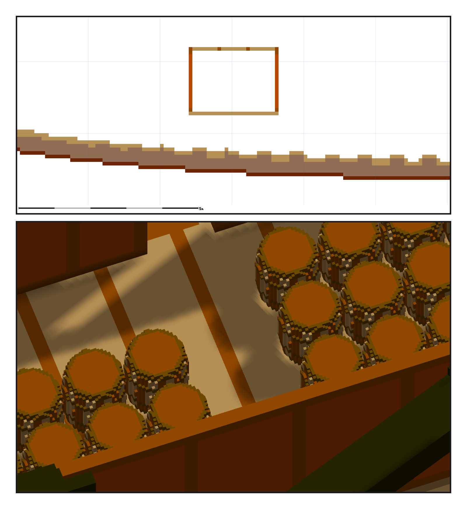

# 第 060 話〈水線底下的房間〉

## P1 — 一行 meta、一間房間

**P1-①**〔Y 一七五的剖面：船底，和上面一個方框〕
　字幕：「水線：船尾七十八、船中七十五、船頭七十二。遊戲只收一個數，ame 要船中那一個。一行 meta，沒有格子。」
　字幕：「彈藥庫放船尾貨艙，地板蓋在 keelson 頂上。這一刀切不到撐著它的地方，看起來像懸著 —— 我拿的是元件數一，不是這張圖。」

**P1-②**〔從上往下看：五十六桶〕
　字幕：「二十二門照憲法號換算：五十六桶、五千六百磅 —— 換算，不是史料。起點二三六放得下一百一十八、二五二放不下、二四八放七十 —— 三個數都是程式算的，我只挑。」
　字幕：「匯入檢查：四個警告剩兩個，剩的是站位，跟補之前一字不差。」
