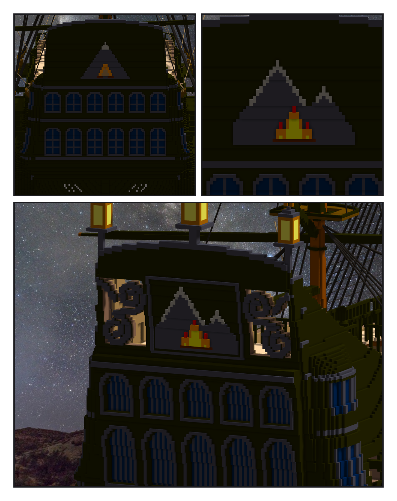

# 第 061 話〈看得到不是出處〉

## P1 — 船尾

**P1-①**〔第一版的船尾：兩排拱窗、山上一個空心的 A〕
　字幕：「查到三盞船尾燈、quarter gallery 的窗、『almost Baroque』；窗有幾扇查不到。模型照上看得到一排拱窗 —— 看得到不是出處。我在程式開頭分開標：二手、讀圖、我設計的。」
　字幕：「金色色號 177 其實是褐的，火做成三角形、中間空著，遠看是一個字母。」

**P1-②**〔第二版的徽：兩座山、一堆火〕
　字幕：「改成火舌與亮黃的芯，山換成兩座，一高一低 —— 不對稱的一百一十九格，是我設計的。」

**P1-③**〔套用之後：三盞燈插在柱上〕
　字幕：「第三版第一次跑，浮空斷言擋下四塊：刻窗那一欄沒設深度，順著船尾樓側牆一路刻了進去。上限七格。」
　字幕：「Tim：『測試ok 套用草稿，掛三盞船尾燈』。中間那盞最高；燈罩是黃色的玻璃格，渲染器點不亮它。」
