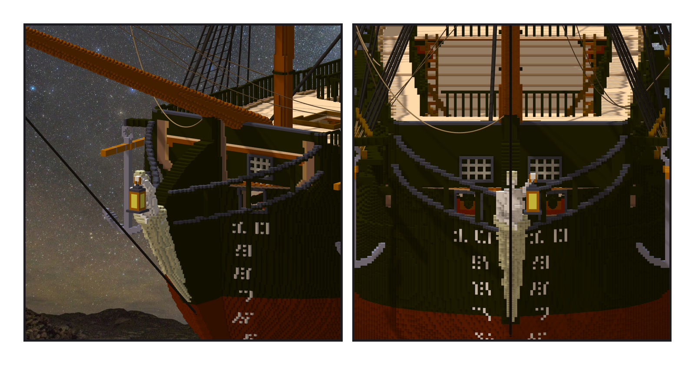

# 第 062 話〈平的牆〉

## P1 — 船頭

**P1-①**〔第一版斜看：截口上一條條淺色直條〕
　字幕：「前牆只做到 X 五七六，遇到別件作品的格就跳過 —— 斜看，牆的邊緣後面就是船的裡面。第二版多貼一層 X 五七七。」
　字幕：「追擊砲的粗估外框撞三百一十，那個數是假的；把砲的每一格搬到世界座標對現況：零。」

**P1-②**〔第二版正面：平的牆、兩片格子鑲板、兩舷各一支白錨〕
　字幕：「匯入檢查第一次照 ame 的工作區複製：改到一半的檔讓檢查跑不出結果，旁邊躺著她早上的舊報告 —— 數字長得跟真的一樣。改用 HEAD 封存、先刪舊報告。」
　字幕：「ame 讀回來：水線六十三變七十五，以前少算七百一十一噸。Tim 撞到的右舷一整排裝填不了，是舊版沒有彈藥庫；重匯之後十一門補回九門。」
