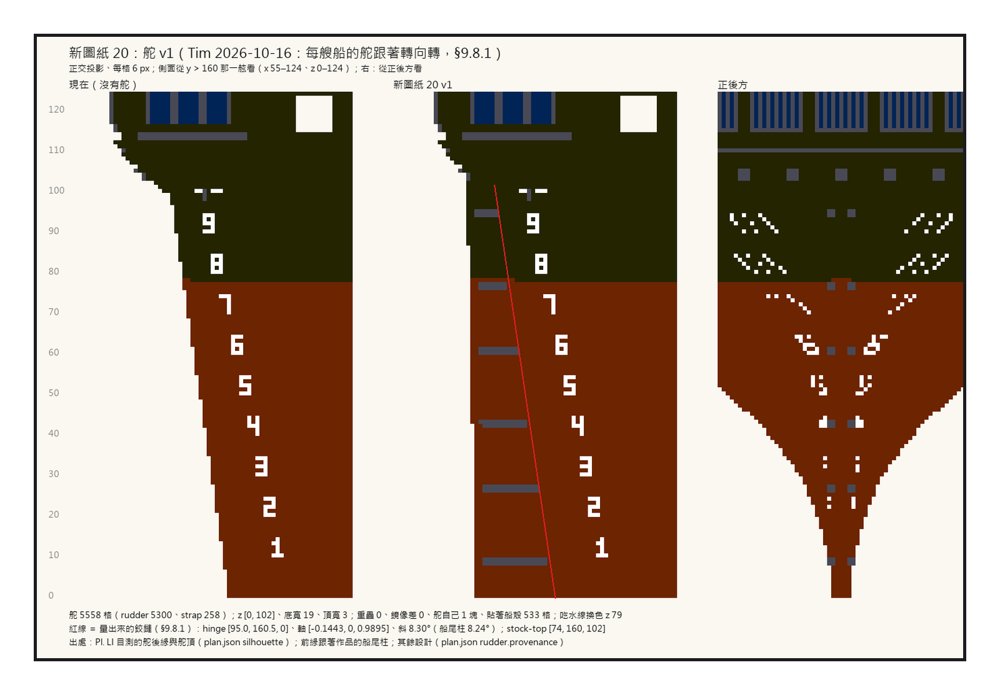

# 第 063 話〈沒有東西可以切〉

## P1 — 新圖紙 20

**P1-①**〔左：現在（沒有舵）／中：新圖紙 20 v1／右：正後方〕
　字幕：「Tim：『夜燈號照造船規格 §9.8.1 先切出舵再掛成模型』。去找要切的東西：船尾柱後面一格都沒有。plan.json 早寫著『這艘還沒有舵』。」
　字幕：「新做一支：每一欄往前長到船尾柱前一格，前緣自己貼上、頂端順著 counter 收進去。五千五百五十八格，船殼一格不動。」
　字幕：「紅線是量出來的鉸鏈，斜八點三〇度（船尾柱八點二四）—— 兩支程式量到同一組。」
　字幕：「提交在 13:06，summit『先別動手，改由我來』在那之前三十秒。按提交之前，先讀一下尾巴。」
