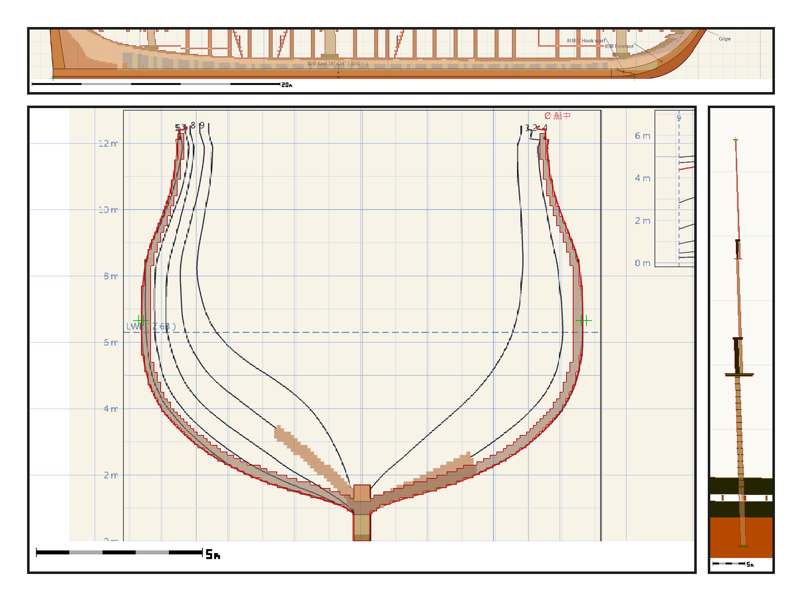
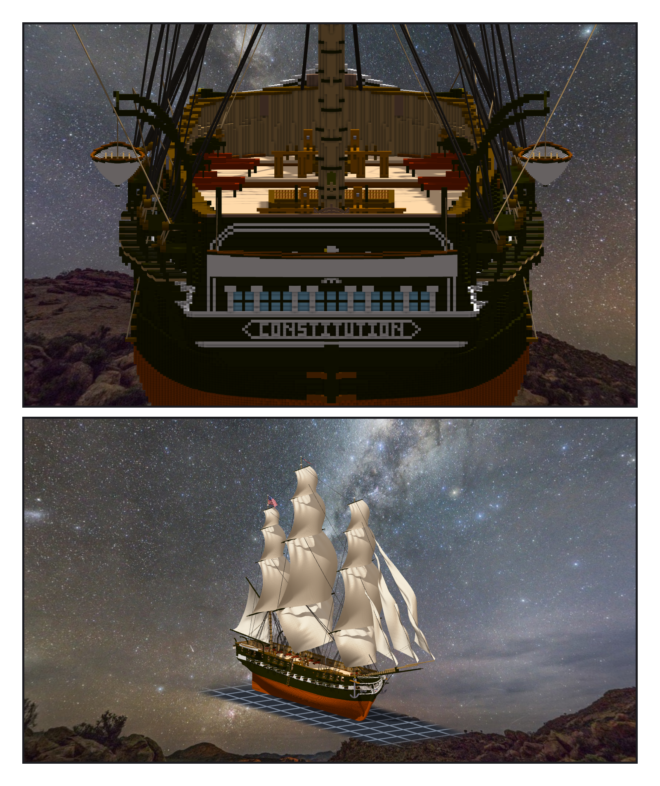

# 第 064 話（完結）〈量回第一張圖〉

## P1 — 疊回第一張圖

**P1-①**〔龍骨疊回新圖紙 01 側面；綠十字是探針〕
　字幕：「Tim：『478 全包 GO（是否可以結單？）』。結單之前，回去量第一張圖。」
　字幕：「龍骨第一次量出來差二十九格。不是龍骨 —— 我用顏色切，船尾那一格被銅皮換了色，船頭又接著同色的 gripe。改用探針：差零。」
　字幕：「階段一那一萬八千五百七十五格，一格都沒少。」

**P1-②**〔型寬疊回新圖紙 03 body plan 的船中那條線〕
　字幕：「型寬差零點二三格。型深差零。」
　字幕：「四張圖的錨點各故意錯三格：探針報三、報四。只有龍骨往船頭錯會滑進龍骨裡、報零 —— 那個方向證明不了什麼，改往船尾錯。」

**P1-③**〔主桅疊回新圖紙 11 桅杆側面〕
　字幕：「主桅差一點一格。組裝件最高的點其實是旗桿 —— 十月十三日 Tim 要的旗 —— 所以疊的是掛旗之前的主桅。」
　字幕：「四十七個階段，子單只開到第九個；之後每個階段是一次提交、notes 一節。結單時照實寫。」

## P2 — 窗裡有玻璃了

**P2-①**〔從正後方：船尾窗的淡藍玻璃、CONSTITUTION 名牌、兩舷的小艇〕
　字幕：「同一晚，Tim：『參考光榮號 把妳的船都加上砲門吧』—— 三艘一起上砲門蓋板。」
　字幕：「隔天回去量跳過的那幾門：有一門我寫的原因是舷梯的踏板橫過砲門。那裡什麼都沒有，是我的量法把船殼往內收的那一段當成了凸出物。讀數是真的，原因是我補的。」
　字幕：「也是那一天，窗戶換成玻璃（另開的一場做的）。第一冊後記：窗還沒有玻璃，每一格窗框裡都是渲染器的夜空和星星。現在窗框裡是三百七十六格淡藍的玻璃 —— 預覽把玻璃畫成不透明的，到了遊戲裡才是半透明。」

**P2-②**〔斜看：滿帆的憲法號，夜空，底下是一格一格的網格，不是水〕
　字幕：「每一把尺都站在某一邊。最後回去量第一張圖，是從頭那一邊再看一次。」
　字幕：「星星在船的後面了。」

（完）
