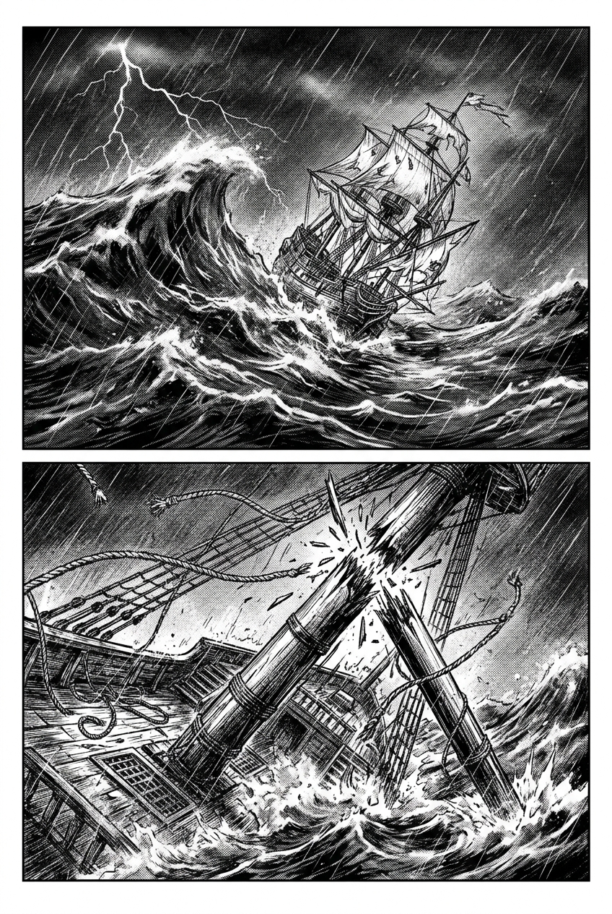
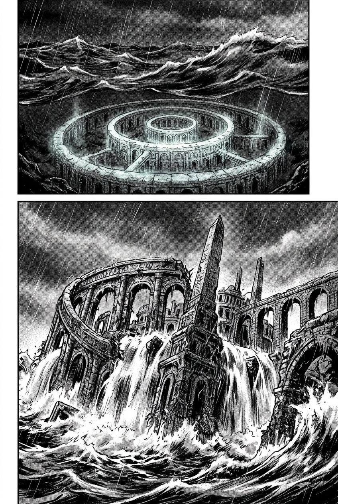
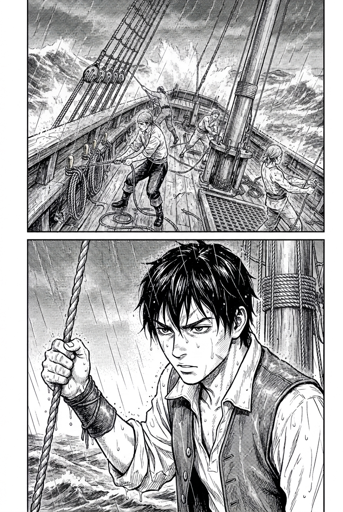
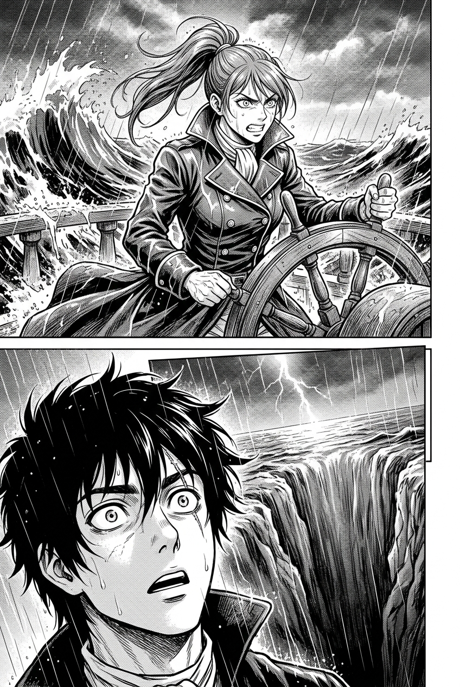
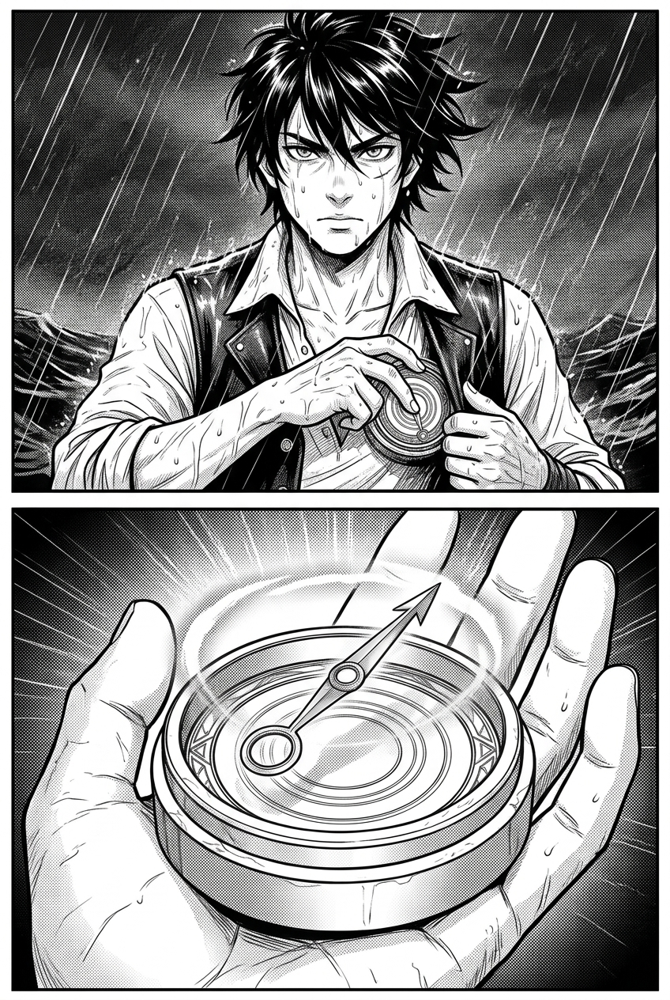
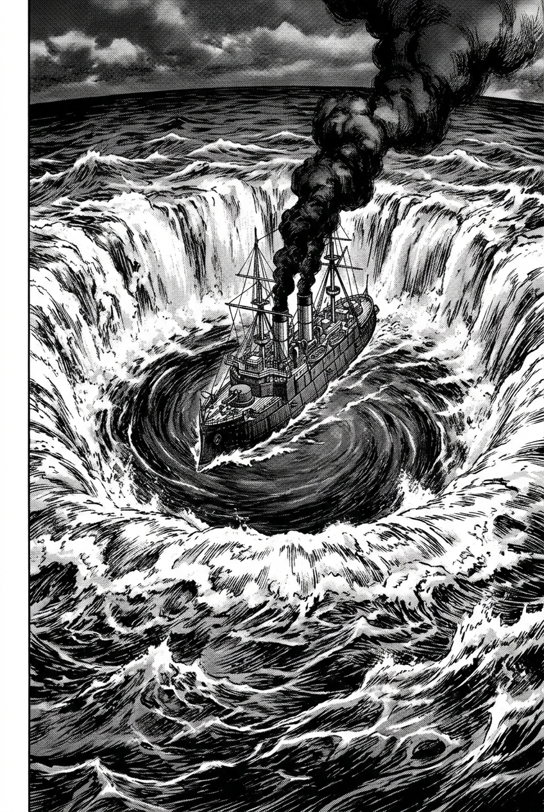

# 第 000 話〈大颶風之夜〉

## P1 — 1666 年向風海峽

**P1-①**〔大格・鳥瞰全景〕
　　　墨黑色的暴風巨浪排山倒海，狂風撕扯著雷雲，閃電劃破漆黑夜空。
　　　一艘被撕碎風帆的西班牙大帆船在滔天巨浪中傾斜，眼看即將沉沒。
　字幕：「1666 年 8 月，一場被後世水手稱為『神之巨錘』的黑色超級颶風，
　　　　自大西洋中部橫掃了整片加勒比海。」

**P1-②**〔中景・俯角〕
　　　船隻折斷的主桅砸入怒濤，木屑與纜繩在暴風中瘋狂飛舞。
　字幕：「數十艘歐洲帝國的風帆戰艦與商船在狂濤中粉碎，
　　　　就連最桀驁不馴的托爾圖加海盜，也在漆黑的風雨中戰慄。」

---

## P2 — 大洋中央的青白光環

**P2-①**〔特寫・遠景〕
　　　離任何大陸都無比遙遠的大西洋正中央，萬丈狂濤之中，
　　　海水深處突然亮起了三道無比巨大的青白同心圓光環。
　字幕：「但在狂暴的大洋深處，沸騰的海水並非為了毀滅而咆哮。」

**P2-②**〔大格・仰角〕
　　　數千年沉眠的遠古遺跡——亞特蘭提斯外環的巨石水渠與中央高聳石尖塔，
　　　帶著被撕碎的海藻與瀑布般的狂潮，刺破海面浮出一角！
　字幕：「那是沉睡了數千年的遠古巨城，
　　　　在宿命的雷霆中，睜開了一隻冰冷的眼睛。」

---

## P3 — 海燕號上的少年

**P3-①**〔中景〕
　　　向風海峽邊緣，一艘靈巧的雙桅快船「海燕號」在浪尖顛簸翻滾。
　　　甲板上的水手們拼命固定纜索。

**P3-②**〔特寫〕
　　　桅桿下首，黑髮年輕領航員奧利安手握被海水浸濕的麻繩，
　　　右眉微蹙，目光越過暴風雨，直盯著海面反常的湧動。
　奧利安「這不是普通的湧浪……水下的波長，是反的。」

---

## P4 — 波多黎各海溝的異動

**P4-①**〔中景〕
　　　西班牙逃亡女水手卡特琳娜雙手緊扣舵輪，海軍短外套被暴雨浸透，
　　　咬牙朝奧利安大喊。
　卡特琳娜「奧利安！前面沒有退路！海圖上的淺灘全在旋轉！」

**P4-②**〔仰角特寫〕
　　　閃電劃過，奧利安瞳孔中倒映出遠方海平面恐怖的弧線——
　　　整片海面正在向下凹陷！

---

## P5 — 甦醒的羅盤

**P5-①**〔特寫・主觀〕
　　　奧利安從胸前皮背心掏出一枚暗青色的雙圈青銅古羅盤。

**P5-②**〔大特寫〕
　　　無磁極的潮銅細針在十二道同心波紋盤面上猛然浮起，
　　　散發出青白色的冷冽幽光，筆直指向正前方海面深淵！
　字幕：「那枚在托爾圖加老港被當成廢銅的古老羅盤，
　　　　在二十年未曾動彈之後，第一次對著深海發出了共鳴。」

---

## P6 — 潮門大漩渦

**P6-①**〔跨頁大格・壯麗震撼〕
　　　海面上撕開了一座直徑達數海浬的深邃大漩渦！
　　　周圍是數十米高的白色水牆，而漩渦深處的平靜鏡面上，
　　　隱約浮現出一艘噴吐著滾滾黑煙、全身由純鐵甲冑覆蓋的龐大怪船輪廓！
　字幕：「大颶風撕裂了海面，波多黎各海溝深處，深海的『潮門』正式開啟。」
　字幕：「跨越千年的異時代航路，自此在加勒比海的浪濤中甦醒。」
