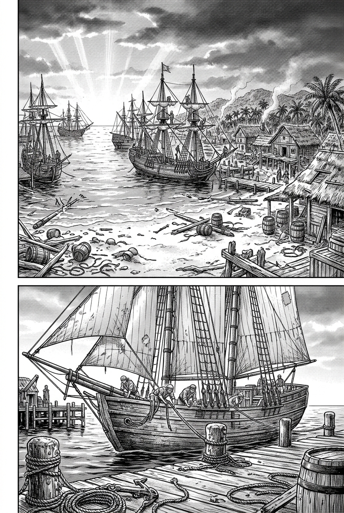
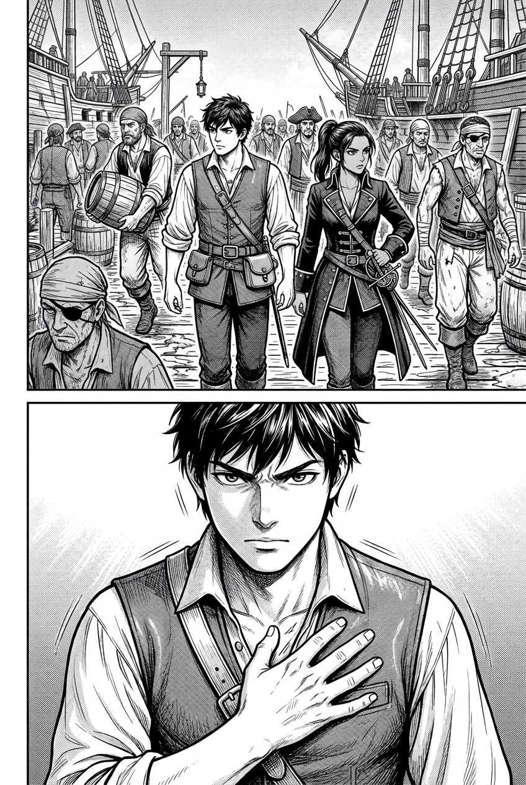
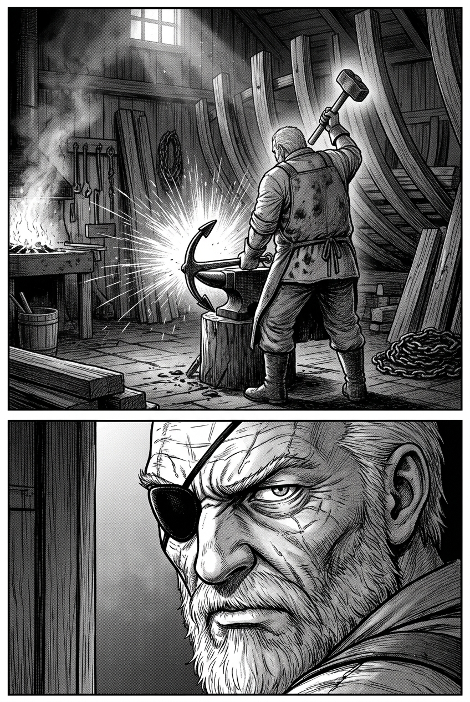
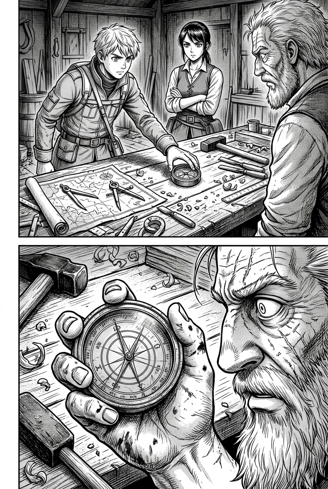
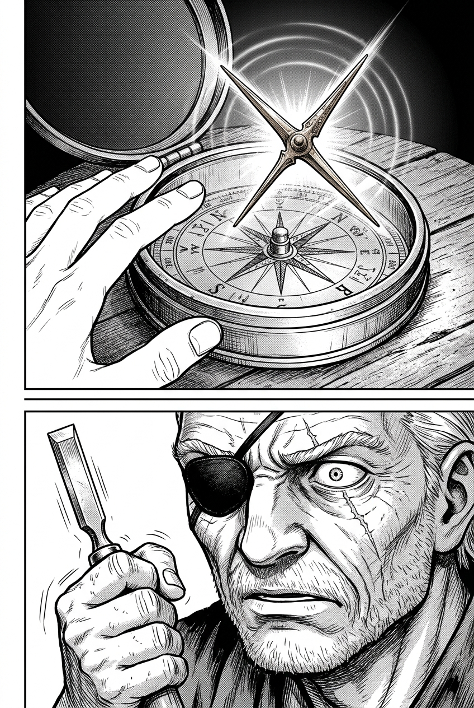
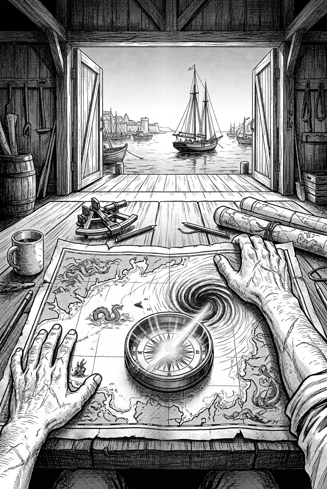

# 第 001 話〈托爾圖加的盲眼老船長〉

## P1 — 晨曦中的海盜港

**P1-①**〔大格・全景仰俯〕
　　　暴風雨消散的次日清晨，金紅色的朝陽撕開殘留的烏雲，照耀著加勒比海的法外之地——托爾圖加島。
　　　海灣中漂浮著斷裂的檣木與被沖上沙灘的碎木桶，十數艘海盜快船正在港灣內修補纜索，碼頭炊煙嫋嫋。
　字幕：「黑色超級颶風過後的清晨，托爾圖加島的空氣中瀰漫著濃烈的鹹海水與濕木焦油味。」

**P1-②**〔中景〕
　　　雙桅快船「海燕號」帶著滿身鹽霜與破損的邊帆，緩緩滑入老造船塢外的深水泊位。
　　　甲板上的水手們精疲力竭地拋出繫泊纜繩，纜繩沉重地砸在木樁上。
　字幕：「在向風海峽邊緣撿回一條命的人並不多，而海燕號是極少數全船生還的幸運兒。」

---

## P2 — 碼頭的喧囂

**P2-①**〔中景・水平視角〕
　　　潮濕泥濘的木板碼頭上，各色加勒比浪人、朗姆酒桶商人與負傷的海盜水手熙熙攘攘。
　　　奧利安與卡特琳娜並肩穿過人群；卡特琳娜一手按在腰間雙刺劍柄上，眼神銳利警惕。
　卡特琳娜「全港都在傳言……昨晚向風海峽以東的海面上，有人看見了燃燒著黑煙的鐵甲怪船。」

**P2-②**〔特寫〕
　　　奧利安神色凝重，右手下意識按住皮背心內側口袋，那裡的古羅盤正持續傳遞著微弱的共鳴震顫。
　奧利安「那不是傳言。昨晚在海面凹陷的大漩渦裡，我也看見了。」
　奧利安「走吧，這島上只有一個人能認出這東西的合金。」

---

## P3 — 昏暗的老船塢

**P3-①**〔中景・逆光環境〕
　　　巨大的木造船棚內，空氣中漂浮著木屑與燃燒松節油的青煙。
　　　四處堆放著巨大的龍骨肋骨木材、銅鉚釘與鍛造爐。老船匠巴托洛繆正背對門口，掄起重錘猛烈鍛打一具鐵錨。
　火星四濺，沉悶的金屬撞擊聲在空曠的船塢內迴盪。

**P3-②**〔特寫〕
　　　巴托洛繆停下錘子，轉過滿是深皺紋與花白鬍鬚的蒼老面孔。
　　　黑皮眼罩遮住左眼，僅剩的銳利右眼從眉弓下掃視著走進來的兩人。
　巴托洛繆「我這不修被暴風嚇破膽的懦夫船。如果海燕號的龍骨裂了，去沙灘上把它劈了當柴燒。」

---

## P4 — 落在工坊桌上的羅盤

**P4-①**〔中景〕
　　　奧利安沒有反駁，只是默默走上前，將那枚磨損的暗青色雙圈古羅盤輕輕放在鋪滿木工量規與海圖的長桌上。
　卡特琳娜「老爹，我們不是來修龍骨的。」

**P4-②**〔特寫〕
　　　巴托洛繆冷哼一聲，隨手放下鐵錘，用布滿老繭與焦油的大手捏起羅盤。
　　　老人的眉頭突然猛烈擰緊，目光死死鎖定在羅盤邊緣那三道極細微的同心環雕紋上。
　巴托洛繆「……這東西，你從哪裡挖出來的？」

---

## P5 — 甦醒的微芒

**P5-①**〔大特寫〕
　　　奧利安伸手靠近羅盤。
　　　毫無磁石反應的極細金屬浮針突然懸空而起，針尖與圓環尾部在幽暗的工坊裡綻放出清澈冷冽的青白微光！
　　　細微的同心光波在空氣中緩緩蕩漾，筆直指向東南方。

**P5-②**〔特寫・反應〕
　　　巴托洛繆僅存的右眼瞳孔驟然收縮，拿著填縫錐的手竟微微顫抖起來。
　　　三十年未曾在海風中變色的老海盜臉上，浮現出一種混合著恐懼與近乎朝聖的震撼。
　巴托洛繆「……潮銅（Orichalcum）。它不是傳說……那座該死的深海巨城，真的醒了。」

---

## P6 — 泛黃古海圖與深淵潮門

**P6-①**〔跨頁大格・壯麗特寫〕
　　　巴托洛繆一把扯開一張被鹽漬與血斑浸透的泛黃羊皮古海圖，重重拍在桌上！
　　　青白微光的羅盤指針正精準重疊在海圖上波多黎各海溝邊緣那片空白的古老深淵標記上。
　　　窗外，海燕號在陽光照耀下的海浪上輕輕搖曳，暴風雨後的新航路正等待啟程。
　字幕：「『那不是指引北方的指南針，孩子。』巴托洛繆低沉沙啞的聲音在船塢裡迴響。」
　字幕：「『那是遠古亞特蘭提斯的鑰匙……大颶風打開了潮門，這片大海，再也不會是從前的模樣了。』」
