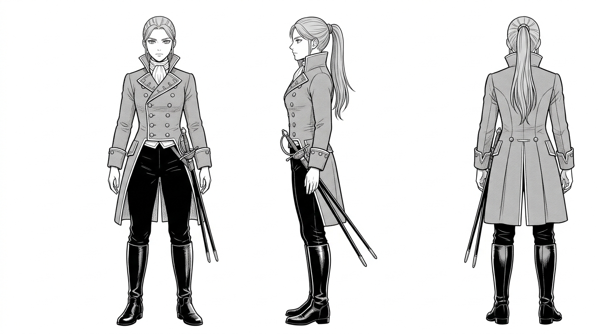

# 卡特琳娜（Catalina）— 文字人設

## 一、身分與性格
- **年齡**：約 21 歲。
- **身分**：曾為西屬美洲珍寶船隊護航艦上的舵手，因拒絕執行虐殺奴隸命令而叛逃，流亡於加勒比海域，隨後加入托爾圖加海岸兄弟會。
- **性格**：幹練、果敢、嘴硬心軟。戰鬥風格凶悍敏捷，擅長近身雙刀刺擊與燧發槍速射。

## 二、外型特徵與服裝
- **髮型與面貌**：深紅褐色長髮束成俐落的高馬尾；琥珀色眼眸，左耳戴著一枚銀質小圈耳環。
- **服裝**：
  - 深藍色修身立領海軍短外套（金屬扣磨損）、腰繫一條鮮艷但微褪色的洋紅腰巾。
  - 白色緊身襯衫、皮質護腕、腰間斜掛兩把西班牙刺劍與一柄短火槍。
  - 深色皮褲與高筒翻折馬靴。
- **姿態**：挺拔而富有警惕感，手隨時搭在腰間刀柄上。

## 三、三視圖人設（`RawImages/catalina_v1.png`）

- 正面、側面、背面三視圖；純白背景，等高等比，中性站姿，零文字標註。已通過目視檢驗。
