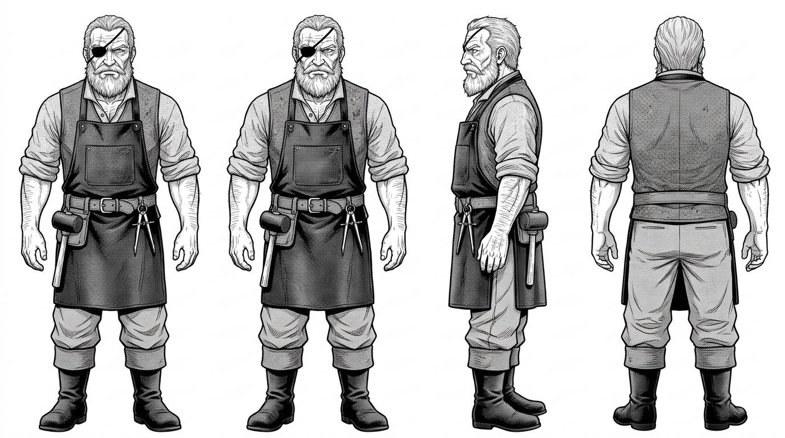

# 巴托洛繆老爹（Old Bart）— 文字人設

## 一、身分與性格
- **年齡**：約 62 歲。
- **身分**：托爾圖加海盜自由港深處老船塢的主持人，曾是橫渡三大洋的傳奇水手長。年輕時曾在馬尾藻海遇難漂流，見識過海底古城的微芒。
- **性格**：脾氣火爆但見多識廣、心細如髮。嘴上總是罵罵咧咧罵年輕人不知死活，但對船隻結構與古老航海傳奇比誰都敬畏。
- **正典關鍵**：托爾圖加唯一認得出「潮銅（Orichalcum）」真實來歷的人。

## 二、外型特徵與服裝
- **面貌**：粗獷硬朗的花白大鬍子、滿臉海風烈日雕刻的深皺紋；左眼失明，戴著一具磨損的黑皮眼罩。右眼目光如鷹隼般銳利。
- **體型**：身材結實魁梧，即便年過六旬依然有著能掄動大鐵錘的粗壯雙臂。
- **服裝**：
  - 深灰色粗毛呢背心，外罩一條滿是焦油、木屑與機油痕跡的皮革圍裙。
  - 捲起雙袖的灰色粗布襯衫，露出手臂上褪色的古錨與海蛇刺青。
  - 厚實的帆布工匠褲與鋼頭皮靴。
  - 腰間工具帶插著造船填縫錐（Caulking mallet）與黃銅比例圓規。

## 三、三視圖人設（`RawImages/old_bart_v1.png`）

- 正面、側面、背面三視圖；純白背景，等高等比，中性站姿，零文字標註。已通過目視檢驗。
