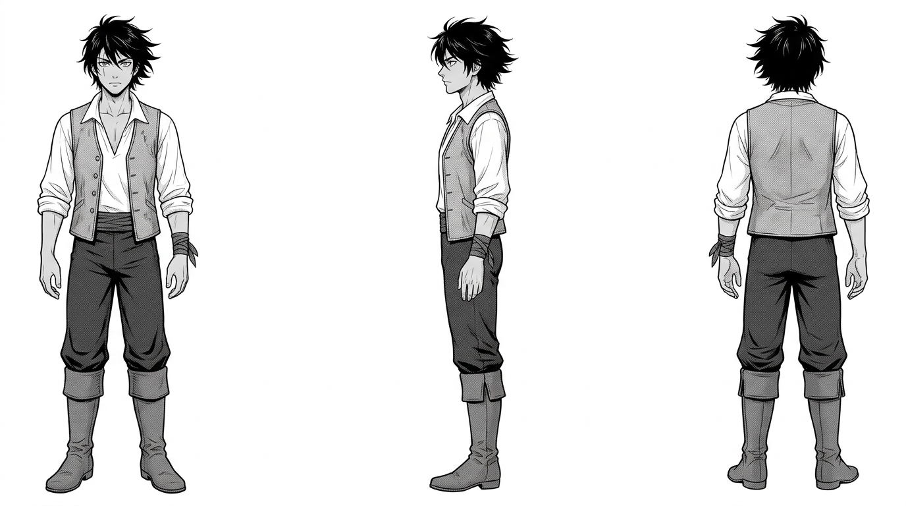

# 奧利安（Orion）— 文字人設

## 一、身分與性格
- **年齡**：約 19 歲。
- **身分**：托爾圖加島出身的年輕水手與天才領航員。從小在礁石與狂浪中長大，對水流深淺、暗湧溫度與風暴氣息有近乎野性的直覺。
- **性格**：沉著、寡言、眼神銳利。在風暴來臨時比任何人都冷靜；對未知世界與古代海圖懷抱極深的好奇心。

## 二、外型特徵與服裝
- **髮型與面貌**：微捲黑短髮、被海風與陽光曬成小麥色肌膚；右眉骨有一道微小淺疤。
- **服裝**：
  - 17 世紀加勒比水手裝束：敞領粗亞麻白襯衫、深褐色皮背心（插著測深鉛錘與銅單筒望遠鏡）。
  - 深灰色耐磨水手長褲、捲口皮靴。
  - 左手腕纏著一圈磨損的防滑麻繩；脖子上掛著用皮繩懸吊的古銅環。
- **姿態**：重心始終很低、站姿極穩，像是一隻隨時準備迎風調整平衡的海鳥。

## 三、三視圖人設（`RawImages/orion_v1.png`）

- 正面、側面、背面三視圖；純白背景，等高等比，中性站姿，零文字標註。已通過目視檢驗。
