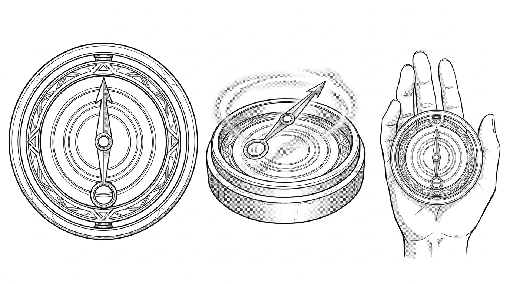

# 潮銅古羅盤（Orichalcum Compass）— 設定

## 一、外型與材質
- **外殼**：約拳頭大小，由厚重的暗青色鍛造青銅打造，邊緣刻有三道微細的同心環紋（亞特蘭提斯標誌）。
- **指針**：並非普通磁石鋼針，而是一根極細的奇異金屬浮針——**潮銅（Orichalcum）**。
- **盤面**：沒有常見的 32 方位羅盤花，而是十二道同心波紋與神秘刻度。

## 二、特殊現象
- 遠離磁場，不指向南北極。
- 當接近深海大漩渦、暗湧導管或古文明遺跡時，潮銅指針會浮起並散發微弱而穩定的青白冷光，指向波長能量最強的核心。

## 三、圖版設定卡（`RawImages/orichalcum_compass_v1.png`）

- 正面頂視、45 度立體透視、手持比例參照三圖；純白背景，零標註。已通過目視檢驗。
- 另備微光特效版：`../RawImages/orichalcum_compass_cyan_v1.png`（青白同心微芒）。
