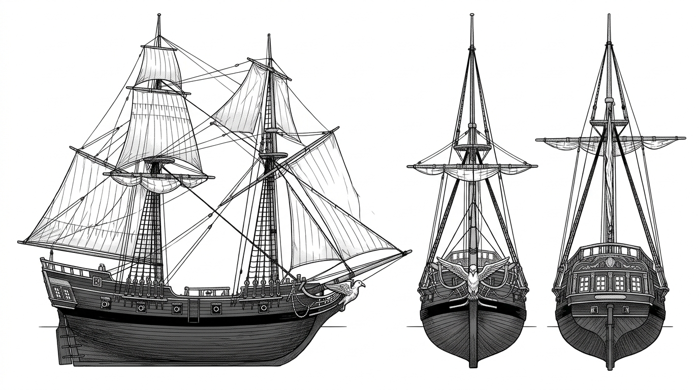

# 海燕號（The Petrel）— 船隻設定

## 一、船型與構造
- **船型**：1660 年代加勒比典型雙桅快船（Brigantine）。
- **特點**：長度約 70 呎，吃水淺、轉向敏捷，極適合在加勒比海珊瑚礁群與淺灘島礁中穿梭。
- **帆裝**：
  - 前桅（Foremast）為橫帆（Square rig）。
  - 主桅（Mainmast）為縱帆（Fore-and-aft gaff rig），兼具順風航速與頂風搶風能力。
- **武裝**：甲板兩舷各配 4 門六磅青銅艦炮（共 8 門），兼顧火力與重量平衡。
- **船首像**：深色硬橡木雕刻的「風暴海燕（Storm Petrel）」，雙翼向後收攏貼緊船首柱，眼神銳利朝向前方。

## 二、外觀特徵
- 船身外板由堅韌的山毛櫸與橡木拼接，塗覆深黑色瀝青防腐，吃水線以上露出風化白松木質感。
- 甲板整潔乾淨，纜索收納整齊，由領航員奧利安精心調校過重心與壓艙石。

## 三、圖版設定（`RawImages/ship_petrel_v1.png`）

- 舷側側面視角、船首正面（海燕船首像特寫）、船艉後視圖；純白背景，零文字標註。已通過目視檢驗。
