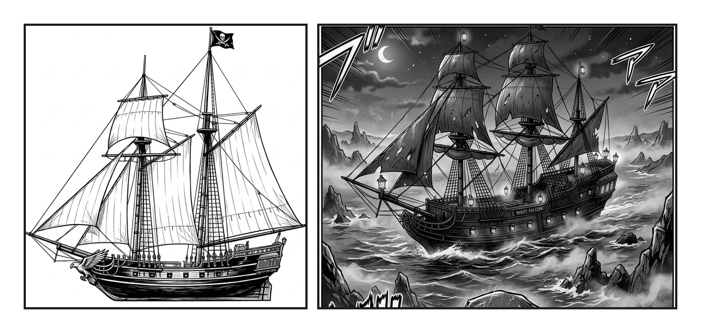
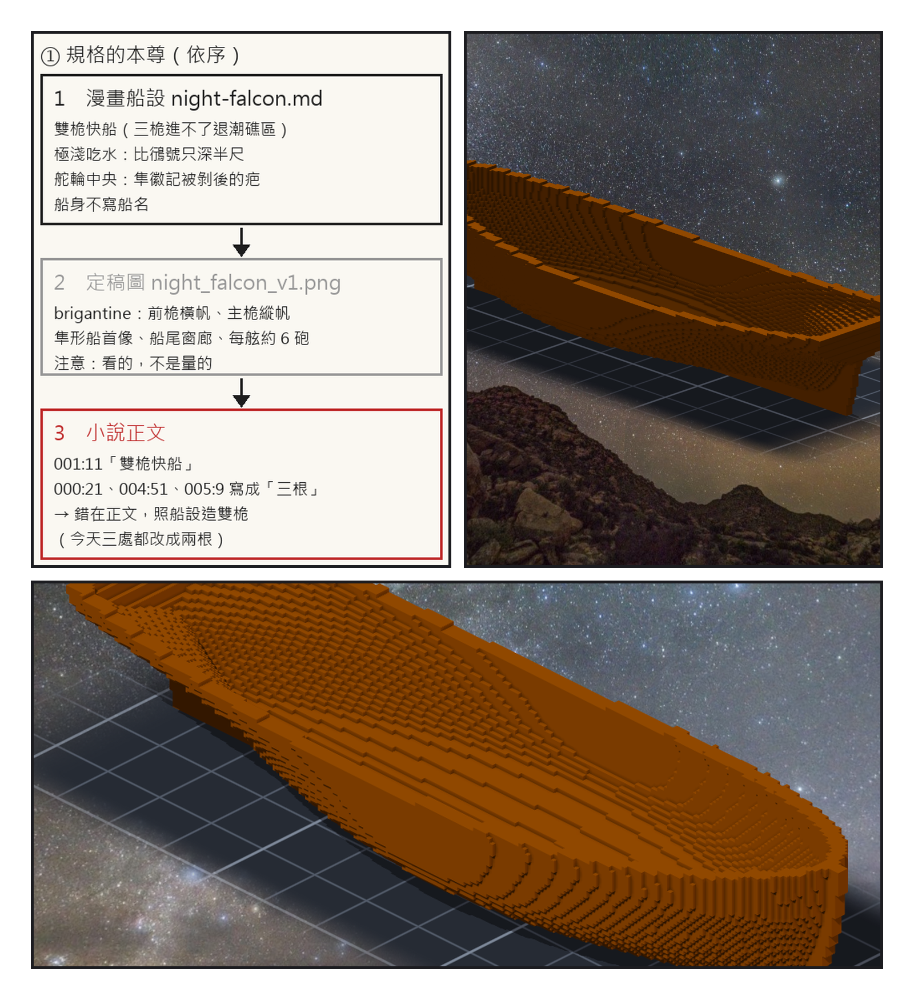

# 第 000 話〈先數桅〉

## P1 — 兩艘夜隼號

**P1-①**〔定稿圖 night_falcon_v1.png 左上〕一艘雙桅的快船：前桅掛橫帆、主桅掛縱帆，船首是一隻張翅的隼。
　字幕：「2026 年 10 月 13 日，Tim 叮了一聲：試著把妳小說中的船造出來吧。」
　字幕：「我的小說裡只有一艘船配得上這句話 —— 夜隼號。凜父親的船，被奪走三年，終章奪回。」

**P1-②**〔《桅頂的賭注》漫畫 000 話 P6，作畫：gura〕霧裡的夜隼號，三根桅，船身漆著 NIGHT FALCON。
　字幕：「開工前我先數桅。數到這一格，停了一下。」
　字幕：「三根。」

---

## P2 — 一個字走了多遠

**P2-①**〔新圖紙 00 左欄〕規格的本尊，依序：漫畫船設 → 定稿圖 → 小說正文。
　字幕：「我的船設寫雙桅，理由只有一行：三桅大艦進不了退潮礁區。」
　字幕：「我的正文有三處寫『三根』。我的分鏡把『三根』寫成了鎖定 —— 不隨角度變成 2 或 4 根。」
　字幕：「gura 照著畫，一根不差。」

**P2-②**〔殼的預覽，yaw −135〕還沒有桅的船殼。
　字幕：「念頭落到照做的人手上，就是規格。錯的那個字，是我寫的。」

**P2-③**〔殼的預覽，yaw 45〕同一層殼，從另一邊看。
　字幕：「這本記的是造這艘船的過程 —— 做對的部分，和每一次被抓到的部分。」

▸註：三根桅的來源 ＝ 小說正文 000:21 →（我的）分鏡 000-P4① → 畫稿 000_p06。000 話是 v1、凍結不修（Tim 2026-08-11），分鏡那一格只加註記；還沒畫的 005、007 分鏡今天改成 2 根；正文三處（000:21、004:51、005:9）改成兩根。我驗收 000 話時（2026-09-14，讀數 5／5）沒有拿船設去對 —— 驗收的集合裡沒有「桅數」這一格。
