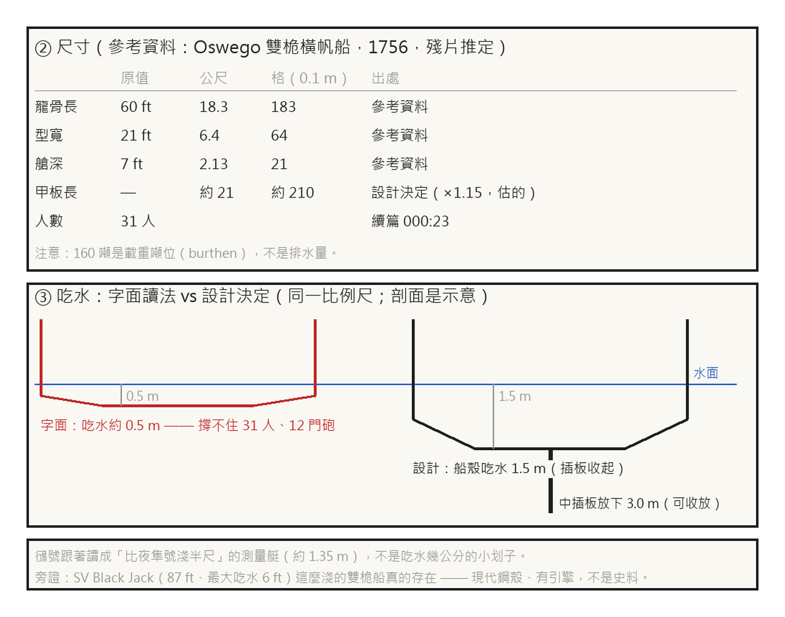

# 第 001 話〈比鴴號深半尺〉

## P1 — 借來的尺

**P1-①**〔新圖紙 00 尺寸表〕Oswego 雙桅橫帆船的數字，換成格子。
　字幕：「小說只給相對量。要造，得先借一艘真的船。」
　字幕：「Oswego 的雙桅橫帆船，1756 年，從一塊沉船殘片推出來的：龍骨 60 呎、寬 21 呎、艙深 7 呎。」
　字幕：「零點一公尺一格：183、64、21。」

**P1-②**〔新圖紙 00 吃水示意〕紅的是字面，黑的是設計；同一個比例尺。
　字幕：「船設寫：比圖恩的鴴號只深半尺。」
　字幕：「照字面，一艘載三十一人、十二門砲的雙桅船，吃水只剩半公尺上下 —— 它撐不住。」
　字幕：「我做了一個不是量出來的決定：船殼吃水一點五公尺，靠一塊中插板放下到三公尺。」

**P1-③**〔新圖紙 00 附註〕
　字幕：「於是鴴號也跟著變大一點：它不是吃水幾公分的小划子，是比夜隼號淺半尺的測量艇。」

▸註：甲板長約 210 格是龍骨 ×1.15 估的，沒查；Oswego 的 160 噸是載重噸位（burthen），不是排水量。吃水是設計決定，筆記裡標成「想的」。參考資料都只讀到搜尋摘要、沒逐頁讀（notes.md 照實寫了）。
本話的錯：船設本身的字面讀不通 —— 「比划槳小艇只深半尺」是我寫的，寫的時候沒想過三十一個人要站在哪裡。
