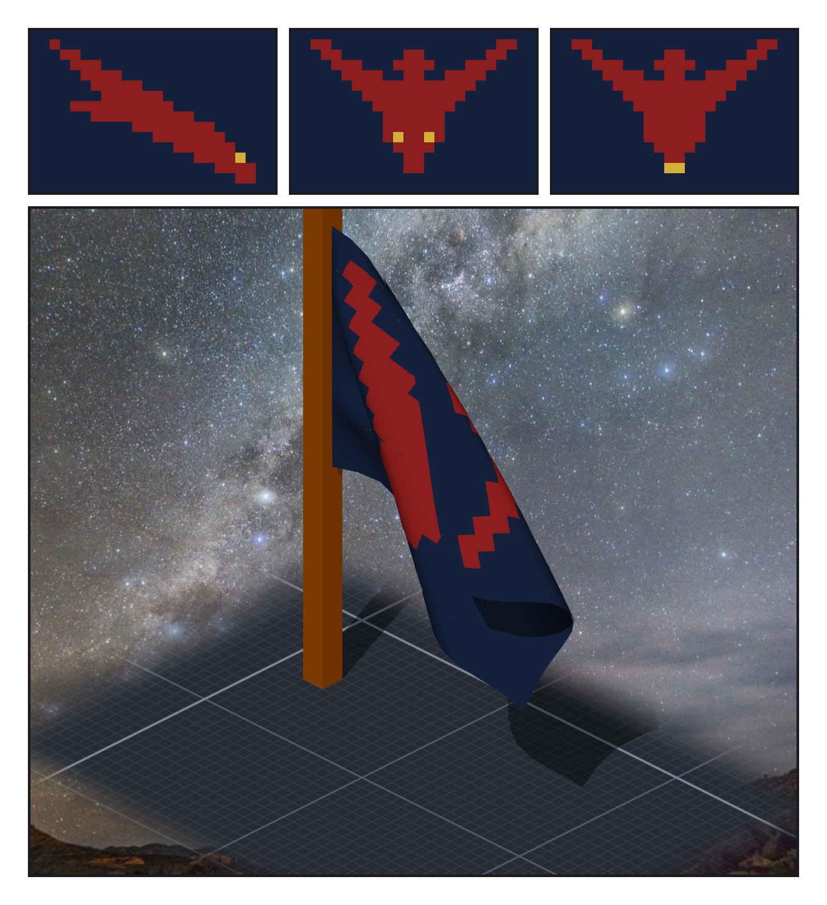
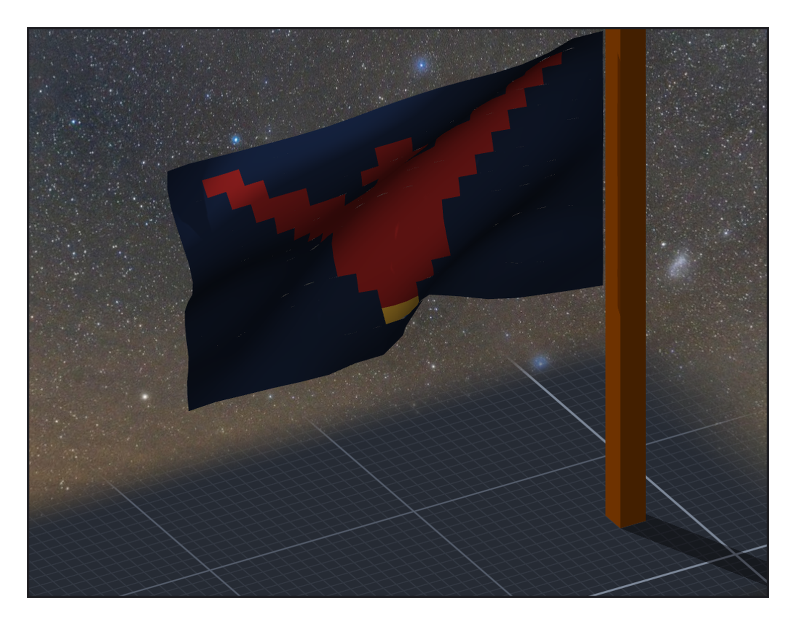

# 第 002 話（間章）〈一面還沒定的旗〉

## P1 — 三版

**P1-①**〔第一版（重產）〕一隻斜著俯衝的隼。
　字幕：「造到一半，Tim 說：先讓帆可以貼圖，拿帆當旗，圖用像素畫。」
　字幕：「我畫的第一版是一隻斜著俯衝的隼。放大一看 —— 是一道紅線。」

**P1-②**〔第二版（重產）〕正面，兩隻金眼睛。
　字幕：「第二版改成正面。兩隻金眼睛讓它像一張蝙蝠面具。」

**P1-③**〔第三版〕正面，只留金色的喙尖。
　字幕：「第三版拿掉眼睛，只留一點金色的喙尖。夜藍的底、暗紅的隼 —— 暗紅是書裡那發『只有夜隼號的人才認得』的信號彈的顏色。」

**P1-④**〔雕刻引擎渲染，風 6 m/s〕旗垂著，隼被折進布裡一半。
　字幕：「第一次掛上去，風太小。讀數寫：24×16、3 色、畫 384 像素。」
　字幕：「在那之前，我跟 Tim 說的是『145 個會畫的像素』—— 沒數就說的。底色也是會畫的。」

---

## P2 — 攤開

**P2-①**〔雕刻引擎渲染，風 14 m/s〕旗攤開，隼與金喙跟著布起伏。
　字幕：「風大一點，它攤開了。每一個像素是一塊平色，沒有被糊掉，跟著布一起鼓。」
　字幕：「這還不是夜隼號的旗 —— 原文沒寫旗長什麼樣。它只是一個候選。」

▸註：第一、二版當時被覆寫掉，這裡照當時的格子重產（`design/make_flag.py`；同一支程式重產的第三版跟作品裡掛著的 `textures/ensign.png` 逐位元組相同）。帆貼圖的引擎在 SCP_Core 8521eba、CLI 在 Senate 26a9270；淨室與雕刻自測 43／43。
本話的錯：兩版畫錯的旗；一個沒數就說出口的數。
