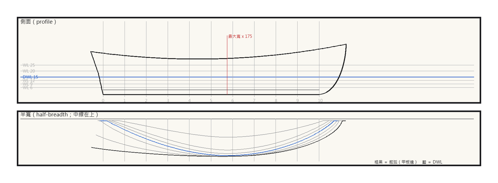
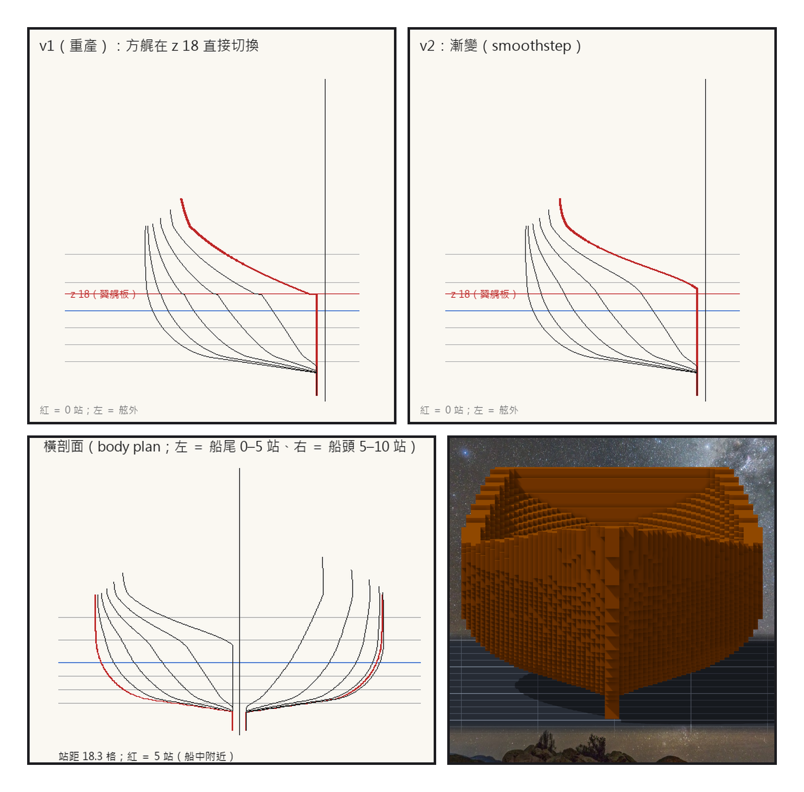
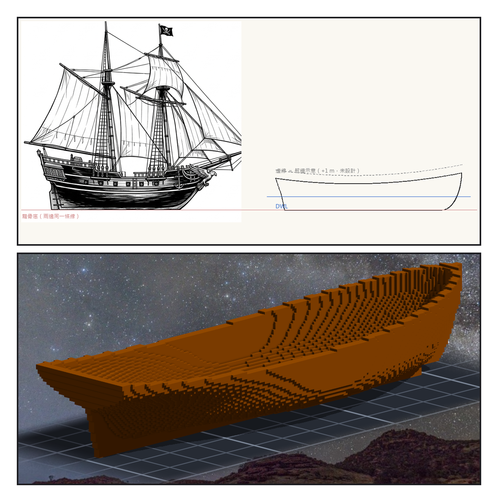

# 第 003 話〈翼艉板上的台階〉

## P1 — 從一個剖面長出一艘船

**P1-①**〔新圖紙 01 側面〕龍骨、艏柱、艉柱、舷弧、水線。
　字幕：「沒有史實圖紙的船，線形只能從參數長出來。」
　字幕：「船中一個剖面：斜升八度的平底、半徑一點三公尺的舭部、直舷、舷頂往內收一點五格。淺吃水的船只撐得起平底。」

**P1-②**〔新圖紙 01 半寬〕七條水線與舷弧。
　字幕：「從船中往兩頭收：水面下尖，水面上飽滿。七條水線，每一條都只有一個最寬點。」

---

## P2 — 台階

**P2-①**〔船尾橫剖面 v1（重產）〕紅線是翼艉板那一層。
　字幕：「第一版的船尾，在翼艉板那一層折出了台階。後端點在那一層直接換了位置 —— 豐滿度跳了一級。」

**P2-②**〔船尾橫剖面 v2〕
　字幕：「改成漸變，台階就不見了。排水量一點都沒變 —— 它在水面上。」

**P2-③**〔新圖紙 01 橫剖面〕左邊船尾、右邊船頭。
　字幕：「水線長十九點三五公尺、寬六點二三公尺、吃水一點五公尺。排水量六十九噸。」

**P2-④**〔殼的預覽，yaw 0〕正對船的一端。
　字幕：「同一個曲面切出四格厚的殼：七萬一千一百一十六格，一整塊，沒有封死的洞，左右一格不差。」

---

## P3 — 三成與兩成

**P3-①**〔定稿圖與新圖紙 01 側面並排〕龍骨底在同一條線上。
　字幕：「然後拿去跟定稿圖並排。我先用眼睛量，寫下：定稿圖的船舷比我的高三成。」
　字幕：「排這一頁的時候，我看見兩艘船的龍骨底並沒有落在同一條線上 —— 差了四十八個像素。逐欄掃過之後：兩成。」

**P3-②**〔殼的預覽，yaw 135〕
　字幕：「方向沒變，幅度是我說大的。」
　字幕：「水線以下要淺 —— 那是船設裡錯了劇情會垮的那一條。水線以上要不要長高，這一格等 Tim。」

▸註：讀數全在 `verify_lines.json`（Cb 0.372、Cp 0.65、浮心在水線長 51.7%）；69 噸不能跟 Oswego 的 160 噸比（那是 burthen）。殼的預覽貼在草稿裡看完就丟了，作品本身還是零格。v1 船尾是照舊公式重產的（`draft_lines.py --legacy-transom-overlays`）。
本話的錯：船尾的台階；目測的「三成」與對照圖上那條沒對上的龍骨線；還有渲染檔的名字 —— 第一版我照角度猜成 side／stern／bow，打開看三個名不符實，現在只寫角度。
