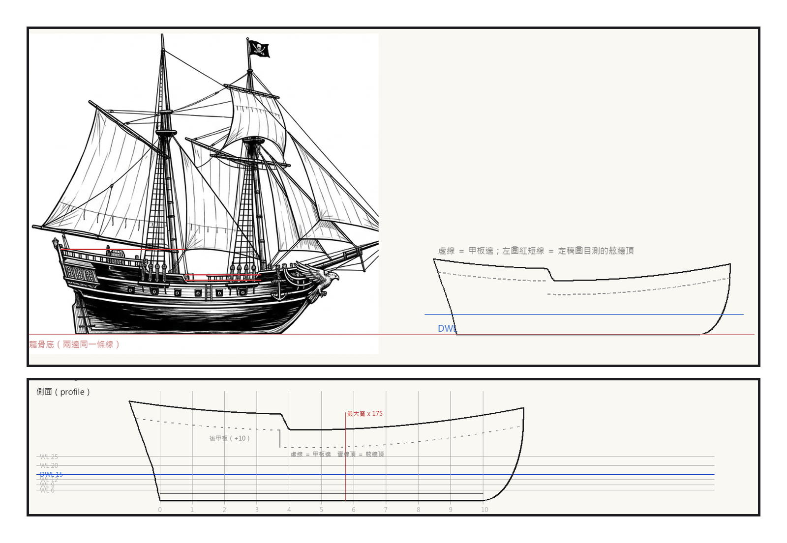
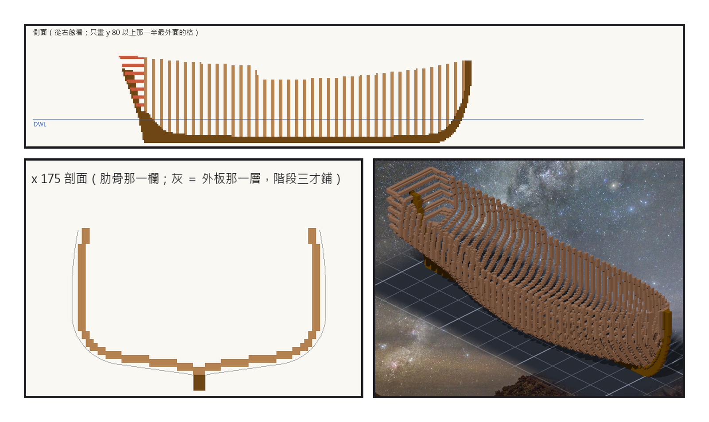
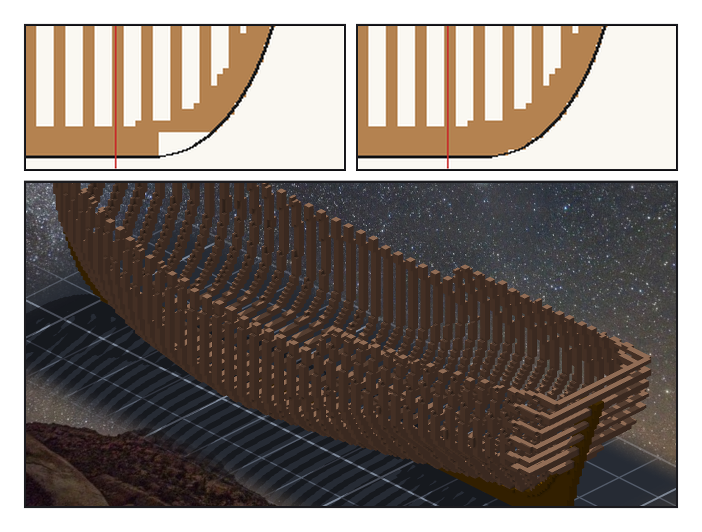

# 第 004 話〈柱子的根〉

## P1 — 水面上的那兩成

**P1-①**〔定稿圖與新圖紙 01 v2 側面並排〕左圖的紅短線是定稿圖上目測的舷牆頂。
　字幕：「Tim 說：這是妳的作品。所以這一格我自己定 —— 水面下不動，水面上補。」
　字幕：「船腰加一公尺的舷牆，船尾加一層高一公尺的後甲板。船腰對上了；後甲板定稿圖還高兩成半，我不追。再抬就是風和重心，對一艘吃水一點五公尺的船，那是錯的方向。」

**P1-②**〔新圖紙 01 v2 側面〕虛線是甲板邊，實線頂是舷牆頂。
　字幕：「水線以下，一格都沒動。」

---

## P2 — 先立骨頭

**P2-①**〔新圖紙 02 側面〕深色是骨架，淺色是肋骨，紅色是艉柱後面橫的 transom。
　字幕：「可以直接切一層四格厚的殼。我沒有 —— 照真船的順序：龍骨、艏柱、艉柱，再一根一根立肋骨。」
　字幕：「肋骨兩格寬、每五格一根，中間空三格。外面那一格先空著，下一階段鋪外板。」

**P2-②**〔x 175 剖面〕灰線是船殼外面。
　字幕：「底肋跨過龍骨，兩側一路爬到舷牆頂，舷牆的立柱就是肋骨自己。」

**P2-③**〔作品，yaw 45〕
　字幕：「五十三根，兩萬四千兩百二十五格。結果帳：缺零、多零、顏色不同零。」

---

## P3 — 柱子的根

**P3-①**〔作品疊新圖紙 01 v2 側面，船頭底下（重產：補格之前那一刻）〕黑線是圖紙，格子是作品。
　字幕：「然後我把作品疊回圖紙上。船頭底下，龍骨前端到艏柱彎上去那一段 —— 線在那裡，格子不在。」
　字幕：「兩本帳都是綠的。作品等於設計；錯的是設計：線形程式把艏柱的根當成了船外。最近的那根探針就站在八格外，問的是肋骨頂和水線那一層。」

**P3-②**〔同一處，補格之後〕
　字幕：「我補了一組沿著柱子的探針。它第一次跑，就在船尾找到同一個病 —— 艉柱的根也空著兩格。」
　字幕：「船頭七十五格、船尾六格。新清單是舊清單的超集，一格都不用刻，重貼就好。」

**P3-③**〔作品，yaw −135〕
　字幕：「兩萬四千三百零六格。骨頭立起來了，風還能從每一根肋骨中間穿過去。」

▸註：讀數在 `verify_lines_v2.json`（69.0 → 69.1 t：補的是水面下那幾格柱根）、`verify_hull.json`（每根木料的格數與 sha256）、`verify_hull_post.json`（探針與反向對照）。定稿圖的舷牆頂是 2 倍放大圖**目測**的（±4 px），不是像素量。P3-① 是照補格前那一刀（作品第 53 個事件）重產的疊圖。
本話的錯：
① 船尾那一區第一版用「最近的船外格在哪個方向」判斷，平手時兩舷挑的方向不同 ⇒ 左右差 360 格。
② 艉板第一版用直的 counter timber，船尾在翼艉板那一層只有艉柱寬 ⇒ 878 格浮在半空。改成橫的 transom 釘在艉柱上（真船也是這樣）。
③ 反向對照第一次跑，y 偏 3 格，探針報 0 —— 我拿偏移後的中線當基準，尺跟著作品一起動。
④ 柱子的根（P3）：讀數全綠，是疊圖用眼睛看到的；量得到它的探針是事後才補的。
